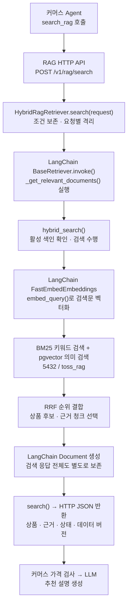

# LangChain 구성도 — HTTP 검색 연결 후

현재 LangChain은 Python RAG 서비스에서 검색 요청의 Retriever 실행과 임베딩 호출에 사용된다.
HTTP 검색은 HybridRagRetriever.search()에서 LangChain BaseRetriever.invoke()를 거친다.

이 구성도는 정상 검색 경로를 나타낸다. 요청 형식과 데이터셋 확인에 실패하면 검색 실행 전에 반환한다.

| 위치 | 적용 방식 | 현재 사용 상태 |
| --- | --- | --- |
| RAG 서버 시작 | create_embedder()와 HybridRagRetriever 객체 생성 | 실제 사용 |
| HTTP 검색 연결 | search(request) → 요청별 Retriever → invoke() | 실제 HTTP 요청에서 사용 |
| 질문 임베딩 | FastEmbedEmbeddings.embed_query() | 검색 실행마다 사용 |
| 근거 표준화 | 근거 문장을 Document.page_content에, 출처·상품·점수를 metadata에 저장 | 정상 검색에서 사용 |
| 콜백·로그 | invoke()의 시작·종료·오류 이벤트, 요청 ID 기반 실행 로그 | 실행 중; 외부 콜백은 RunnableConfig로 지정 가능 |
| 상품·리뷰 색인 | 별도 색인 코드의 embed_documents() | 색인 생성 때 사용; 채팅 때 재실행하지 않음 |

## 요청과 응답 보존

search()는 원문 질문, 검색문, 카테고리, top_k, 가격 필터, 필수 조건과 선호 조건을
요청별로 복사해 전달한다. 같은 Retriever를 사용하는 동시 요청도 각각 독립된 응답을 갖는다.

LangChain invoke()는 Document 목록을 반환한다. HTTP search()는 이 실행에서 보존한
전체 검색 응답을 반환하므로 request_id, dataset_version, applied_filters,
unverified_conditions, items, error_code가 유지된다.

no_results, low_relevance, error 상태를 구분한다. invoke()의 검색 오류는 SearchError로
전달하고, HTTP 경로에서는 검색 엔진이 반환한 오류 상태와 메타데이터를 보존한다.
임베딩·DB 예외는 기존 API의 안전한 오류 코드로 변환한다.

조건 전달을 보존하는 것은 해당 조건을 실제 필터로 검증한다는 뜻이 아니다.
현재 미검증 조건은 unverified_conditions에 남는다.

## 역할과 범위

실제 벡터 계산은 FastEmbed의 임베딩 모델이 수행하고, LangChain은 공통 임베딩 메서드와
Retriever 실행·콜백·Document 인터페이스를 제공한다.

BM25 SQL, pgvector SQL, RRF 랭킹은 기존 검색 코드가 수행한다.
커머스 LLM의 도구 선택, 예산 확인, 가격 검사와 최종 답변 생성은 커머스 Agent 코드가 담당한다.
현재 test_items·beauty 테스트 범위와 모의 가격도 유지된다.

이 연결 자체로 검색 정확도 향상을 주장하지 않는다.

## 코드와 검증 기록

- [HTTP 호출부](../src/toss_ads/rag/api.py)
- [Retriever와 검색 엔진](../src/toss_ads/rag/retriever.py)
- [임베딩 설정](../src/toss_ads/rag/embeddings.py)
- [실행 검증 기록](../../../reports/langchain-http-verification-2026-10-18.json)

작업 브랜치: feature/rag-langchain-http
