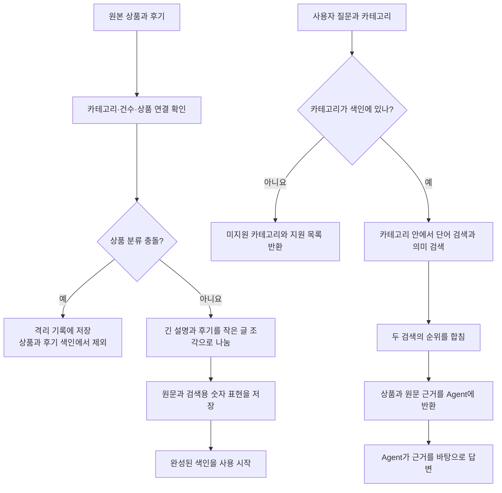

# RAG 전체 흐름과 방향

**한 줄 목표:** 사용자가 고른 카테고리 안에서 상품과 후기의 근거를 찾아 Agent에게 돌려준다. RAG는 최종 답변을 직접 쓰지 않는다.

색인은 정보를 빨리 찾도록 정리해 둔 목록이고, Agent는 사용자에게 최종 답변을 쓰는 부분이다.

## 먼저 알아둘 데이터

- 표본은 의류, 식료품, 가전에서 상품을 각 1만 개씩 뽑았다. 후기는 상품마다 별점별 최대 8개, 모두 합쳐 최대 40개다. 현재 표본은 상품 3만 개, 후기 178,335개다.
- `Clothing_Shoes_and_Jewelry` 같은 값은 표본의 원본 카테고리다. `main_category`는 상품 자료 안에 따로 붙어 있는 분류다. 두 값이 다를 수 있다.

## 전체 흐름

## 색인할 때

1. RAG가 기존 데이터 조회 창구(API)에서 상품과 후기를 나눠 읽는다.
2. 데이터 버전, 예상 건수, 후기와 상품의 연결이 맞는지 확인한다.
3. 명확한 분류 충돌은 격리한다. 격리된 상품과 후기는 검색할 수 없고, 원본 카테고리도 자동으로 바꾸지 않는다.
4. 나머지 상품 정보와 후기를 작은 글 조각으로 나눠 원문, 카테고리, 상품 ID와 함께 저장한다. 뜻을 비교할 숫자 표현도 만들고, `user_id`는 저장 전에 지운다.
5. 전체 검사가 성공한 색인만 사용한다. 중간에 실패하면 이전 색인을 유지한다.

## 검색할 때

1. Agent가 질문과 카테고리를 RAG에 보낸다. 카테고리는 `Appliances`, `Clothing_Shoes_and_Jewelry`, `Grocery_and_Gourmet_Food` 같은 원본 키를 쓴다.
2. 색인에 없는 카테고리면 `unsupported_category`와 지원 목록을 반환하고 검색하지 않는다.
3. 지원 카테고리면 단어가 맞는 검색과 뜻이 비슷한 검색을 각각 실행한다. 두 검색 모두 처음부터 그 카테고리 안에서만 찾는다.
4. 두 결과의 순위를 합쳐 상품과 후기 원문을 반환한다. 해당 카테고리에 결과가 없으면 `no_results`를 반환하며 다른 카테고리를 대신 찾지 않는다.
5. Agent가 반환된 원문을 근거로 사용자에게 답한다.

## 팀별 책임

- **RAG:** 원본 수집, 분류 충돌 격리, 색인, 카테고리 제한 검색, 원문 근거 반환.
- **Agent:** 사용자 의도를 카테고리 키로 바꿔 전달하고, 미지원 안내와 최종 답변을 담당.
- **공동:** 카테고리 요청·응답 규칙과 잘못된 카테고리 결과가 나오지 않는 확인 예시를 합의.

## 현재 상태

- RAG 코드에 분류 격리와 카테고리 제한 검색을 반영했다. 계약 제안은 [`v0.2`](../contracts/amazon-reviews-rag/v0.2/)다.
- DB에 새 색인을 아직 적용하지 않았다. 연결 환경을 준비한 뒤 색인을 다시 만들어야 실제 검색 결과에 반영된다.
- Agent가 카테고리를 보내는 변경과 v0.2 계약 수용은 별도 작업이다.
