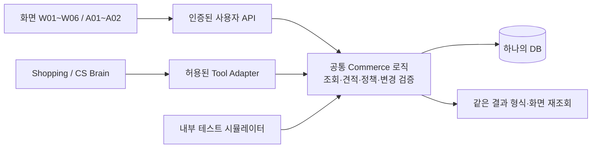

# 최소 DB / Commerce State / Agent Tool 설계

> 2026-10-05 · P0 설계 v1. 기준: [CORE_TASK_SCOPE.md](CORE_TASK_SCOPE.md), [SHOPPING_BRAIN_VISION.md](SHOPPING_BRAIN_VISION.md), [WIREFRAME_PLAN.md](WIREFRAME_PLAN.md). 아래 테이블·상태·정책·계약은 **테스트용 프로젝트의 설계 결정**이며 토스의 실제 내부 구현을 관찰한 결과가 아니다. 코드·마이그레이션·API 구현·실행 테스트는 이번 문서의 범위 밖이다.

## 1. 범위와 구조

지원 과제는 **T1 상품 비교·옵션 선택·장바구니 변경 / T2 소유 주문·배송 조회 / T3 전체 주문 취소 요청·결과 확인**이다. W04의 사용자 직접 모의 결제로 주문을 만들어 세 과제를 연결한다.

**단일 서버 + 관계형 DB + 공통 Commerce 처리 로직**을 사용한다. DB 제품·프레임워크는 지정하지 않는다. 사용자·거래 데이터 11개 테이블과 확인/중복 방지용 실행 요청 1개, 총 **12개 논리 테이블**로 구성한다. 배송 이력은 배송 레코드 내부 배열로 관리한다. 별도 정책 서비스·이벤트 버스·판매자 시스템·벡터 DB는 요구하지 않는다.

화면과 Agent가 각자 금액 계산·취소 판정을 구현하지 않는다. LLM은 조건 해석·추가 질문·근거 비교·설명을 맡는다. 소유권·가격·재고·취소 가능 여부·환불액·상태 전환은 서버가 결정한다.

## 2. 최소 DB 테이블과 핵심 필드

### 공통 규칙

- ID는 서버가 관리하는 식별자다. 사용자 ID는 인증 세션에서 결정하며 LLM 입력으로 바꾸지 못한다. 테스트 사용자도 서로 다른 인증 주체로 구분한다.
- 금액은 모두 **KRW 정수 원 단위**, 수량·재고는 정수다. `created_at`/`updated_at` 등 시각은 UTC로 저장하고 UI에서 KST로 표시한다.
- `version`은 동시 변경 감지용 증가값이다. 카트 항목 변경은 `carts.version`, 주문·결제/환불·배송·취소 관련 변경은 `orders.version`도 같은 트랜잭션에서 증가시킨다.
- 상품/옵션은 주문 후에도 참조를 유지한다. 실제 삭제 대신 비활성화한다. 주문 상품명·옵션·가격은 구매 당시 값으로 보존한다.

| # | 테이블 | 핵심 필드 | 관계·제약·사용 목적 |
| --- | --- | --- | --- |
| 1 | `users` | `id`, `auth_subject`, `display_name`, `test_address_json` | `auth_subject` 고유. 배송지는 테스트용 1개만 사용한다. 주소록·브랜드 선호·생활 패턴 필드는 만들지 않는다. |
| 2 | `products` | `id`, `name`, `brand`, `category`, `description`, `image_urls`, `specs_json`, `active`, `version` | 상품 스펙과 출처를 연결할 기준. `active=false`는 탐색/구매 대상에서 제외하되 과거 주문 조회는 유지한다. |
| 3 | `product_variants` | `id`, `product_id`, `option_values_json`, `spec_overrides_json`, `unit_price_won`, `stock_qty`, `active`, `version` | 상품 1:N 옵션. 가격/재고는 옵션 단위. 옵션이 없는 상품도 기본 옵션 1개를 가진다. 재고 ≥ 0, 가격 ≥ 0. 팩 구성은 옵션 값이며 주문 수량과 다르다. |
| 4 | `reviews` | `id`, `product_id`, `variant_id?`, `rating`, `body`, `source_kind`, `source_ref`, `written_at` | `source_kind=REAL/SYNTHETIC`. 원문·출처를 보존한다. `variant_id`가 있으면 같은 상품의 옵션이어야 한다. 상품 전체 리뷰와 선택 옵션 리뷰를 구분한다. Aspect/임베딩 저장 테이블은 만들지 않는다. |
| 5 | `carts` | `id`, `user_id`, `version`, `updated_at` | 사용자당 1개, `user_id` 고유. 빈 카트도 유지한다. |
| 6 | `cart_items` | `id`, `cart_id`, `variant_id`, `quantity` | `(cart_id, variant_id)` 고유, 수량 ≥ 1. 금액·품절 상태는 현재 상품/옵션에서 계산한다. 가격 복사본을 결제 근거로 사용하지 않는다. |
| 7 | `orders` | `id`, `user_id`, `status`, `items_total_won`, `shipping_fee_won`, `total_won`, `address_snapshot_json`, `version`, `created_at`, `cancelled_at?` | 소유 주문과 구매 당시 금액/주소. `total = items_total + shipping_fee`. 주문 생성 후 금액/상품 구성 수정은 P0 밖이다. |
| 8 | `order_items` | `id`, `order_id`, `variant_id`, `product_name_snapshot`, `option_snapshot_json`, `unit_price_won`, `quantity`, `line_total_won` | 주문 1:N 상품. `line_total = unit_price × quantity`. 과거 주문 표시에 현재 상품명/가격을 덮어쓰지 않는다. |
| 9 | `payments` | `id`, `order_id`, `method=SIMULATED`, `status`, `paid_amount_won`, `paid_at`, `refund_status`, `refunded_amount_won`, `refunded_at?` | `order_id` 고유. 주문당 모의 결제 1개·전체 환불 최대 1회. 승인 금액은 `orders.total_won`과 같다. 실제 카드/계좌 정보는 없다. |
| 10 | `shipments` | `id`, `order_id`, `status`, `events_json`, `estimated_arrival_at?`, `updated_at` | `order_id` 고유. 이력 항목은 `status, occurred_at, note?`. 단일 배송만 지원한다. 정보 없음 테스트에서는 레코드가 없을 수 있다. |
| 11 | `cancel_requests` | `id`, `order_id`, `action_request_id`, `reason_code`, `status`, `refund_amount_won`, `requested_at`, `completed_at?` | `order_id`와 `action_request_id` 각각 고유. 전체 주문 취소 1건만 허용한다. 접수 시 서버가 확정한 예정 환불액을 저장한다. |
| 12 | `action_requests` | `id`, `actor_user_id`, `kind`, `idempotency_key`, `payload_json`, `payload_hash`, `status`, `confirmed_at?`, `expires_at?`, `result_json?`, `error_code?`, `created_at`, `completed_at?` | 카트 변경·모의 결제·취소 실행의 중복 방지와 승인 기록을 공용으로 사용한다. `(actor_user_id, kind, idempotency_key)` 고유. 확인이 필요한 요청은 서버가 인증된 UI 확인을 기록한 뒤에만 생성한다. |

`action_requests.kind`는 `ADD_CART / UPDATE_CART / REMOVE_CART / CHECKOUT / CANCEL_ORDER`로 한정한다. `payload_json`에는 실행 대상·수량·기대 버전 또는 확인한 견적을 저장하며, 이후 변경하지 않는다. 승인 여부를 LLM이 전달한 `confirmed=true`로 저장하지 않는다.

### 따로 만들지 않는 데이터

- 비교/추천 결과는 현재 대화의 상품 ID·리뷰 ID를 참조하는 응답이다. 별도 추천·비교 테이블이나 `compare_products()` Tool은 필요하지 않다.
- 현재 대화의 예산·용도·선호·선택 대상은 세션 Context로 유지한다. 장기 사용자 프로필·Shopping Plan 영속화·자동 재구매·이미지 검색 저장소는 제외한다.
- Tool 호출 기록은 요청 ID, 인증 주체, Tool명, 대상 ID, 결과 코드, 시간/토큰/비용, 근거 ID를 남기는 서버 로그로 충분하다. 업무 성공 여부는 로그 문구가 아니라 DB 결과로 검증한다.

## 3. 최소 상태 모델

| 대상 | 저장 상태 / 파생 상태 | 의미·전환 |
| --- | --- | --- |
| 상품 | `active=true/false`; `AVAILABLE/SOLD_OUT/UNAVAILABLE`는 파생 | 활성 상품에서 활성·재고 양수 옵션이 있으면 AVAILABLE. 활성 옵션은 있으나 모두 재고 0이면 SOLD_OUT. 상품 비활성 또는 활성 옵션 없음은 UNAVAILABLE. |
| 옵션 | `active`, `stock_qty`; `AVAILABLE/SOLD_OUT/UNAVAILABLE`는 파생 | 상품·옵션 활성 + 재고 > 0이면 AVAILABLE. 품절과 판매 비활성을 구분한다. |
| 리뷰 | 별도 업무 상태 없음 | 읽기 전용 원문. `REAL/SYNTHETIC`은 출처 유형이다. 조회 0건과 조회 실패는 서로 다른 응답이다. |
| 장바구니 | 별도 업무 상태 없음 | 항목 없음은 EMPTY, 있으면 NON_EMPTY. 항목별 구매 가능 여부와 총액은 조회 때 계산한다. 담기는 재고 예약이 아니다. |
| 주문 | `CONFIRMED → CANCELLED` | 모의 결제 성공 시 CONFIRMED로 생성한다. 배송 완료 여부는 배송 상태를 보고 판단한다. 취소 요청만으로 CANCELLED로 바꾸지 않는다. |
| 결제 | `PAID` | P0는 성공한 모의 결제만 결제/주문 레코드를 만든다. 결제 처리 중/실패는 실행 요청과 화면 상태이며 미결제 주문을 별도로 만들지 않는다. |
| 환불 | `NONE → PENDING → REFUNDED` | 취소 완료 시 PENDING, 모의 환불 처리 후 REFUNDED. PAID는 결제 이력으로 유지한다. 환불 완료 전 `refunded_amount_won=0`. |
| 배송 | `PREPARING → IN_TRANSIT → DELIVERED`; `PREPARING → CANCELLED` | 준비/배송 중/완료를 표현한다. 취소 완료 시 준비 중 배송을 종료한다. 레코드 없음은 응답의 `NO_INFORMATION`으로 표현하며 배송 중/지연으로 추정하지 않는다. |
| 취소 | 요청 없음 → `REQUESTED → COMPLETED` | COMPLETED는 주문 취소가 완료됐다는 뜻이며 환불 완료 여부는 `payments.refund_status`로 확인한다. 거절된 호출은 취소 신청을 만들지 않는다. |
| 실행 요청 | `READY → SUCCEEDED / REJECTED` | READY는 승인 또는 유효 입력이 기록됐고 최종 실행 결과가 아직 저장되지 않은 상태. SUCCEEDED는 해당 명령 커밋, REJECTED는 업무 변경 없이 확정 거절. 취소 명령 성공은 요청 접수 성공이다. |

`Loading`, `Error`, `결과 미확정`, `리뷰 근거 부족`, `Disabled`는 화면/응답 상태다. 주문 상태에 섞어 저장하지 않는다. 배송 사건 배열의 마지막 상태와 `shipments.status`는 같은 트랜잭션에서 갱신한다.

항상 유지할 조합은 다음과 같다. 상태 모순을 LLM이 해석해 보정하지 않는다.

- `REQUESTED` 취소는 주문 CONFIRMED·배송 PREPARING·환불 NONE과 함께 존재한다.
- 주문 CANCELLED이면 취소 COMPLETED·배송 CANCELLED이고, 환불은 PENDING 또는 REFUNDED다.
- `REFUNDED`이면 `refunded_amount_won = paid_amount_won`, 그 전에는 0이다. 모든 결제 승인 금액은 구매 당시 주문 합계와 같다.
- 배송 레코드 없음은 정보 없음 테스트만 허용한다. 그 주문의 취소는 출고 전임을 검증할 수 없으므로 차단한다.

## 4. 서버 정책과 상태 전환 규칙

### 4.1 금액·장바구니

- **P0 배송비 정책:** 단일 판매자·단일 배송의 고정 배송비 `FLAT_SHIPPING_FEE_WON` 하나를 서버 설정으로 둔다. 빈 카트 배송비는 0, 비어 있지 않으면 고정 금액 1회다. 실제 설정 금액은 Seed 준비 시 정하고 모든 조회/결제에 동일하게 적용한다. 쿠폰·포인트·조건별 무료배송은 없다.
- 같은 옵션을 다시 담으면 기존 수량에 요청 수량을 더한다. 수량 수정은 최종 수량으로 지정하며, 삭제는 별도 명령이다. `quantity=0`을 수정으로 받아 삭제하지 않는다.
- 추가/수정 후 최종 수량이 현재 재고를 넘으면 전체 명령을 거절한다. 카트에 담긴 동안 다른 주문으로 재고가 줄 수 있으므로 결제 때 다시 검증한다. 품절 항목도 삭제는 가능하다.
- 상품 소계는 옵션의 현재 단가 × 수량 합계다. 총예산을 비교할 때 배송비 포함 여부를 설명한다. LLM이 만든 합계나 할인액을 저장하지 않는다.

### 4.2 모의 결제와 주문 생성

W04의 최종 버튼만 실행을 시작할 수 있다. 서버가 카트 전체·옵션별 버전/가격/재고·고정 배송비·테스트 주소를 견적으로 제공하고, 사용자가 확인한 내용과 실행 직전 내용을 비교한다.

**한 트랜잭션:** 실행 요청·카트·대상 옵션을 잠그고 검증 → 옵션 재고 차감 → 주문/주문 항목 생성 → `payments(PAID, NONE)` 생성 → `shipments(PREPARING)`와 첫 이력 생성 → 카트 항목 삭제·카트 버전 증가 → 실행 결과/주문 ID 저장. 일부 상품만 결제하는 결과는 만들지 않는다.

가격/주소/카트/정책이 바뀌면 `STALE_QUOTE`, 재고가 부족하면 `OUT_OF_STOCK` 등으로 거절하고 재확인을 요구한다. 비즈니스 거절은 재고·주문·결제를 변경하지 않는다. 응답만 유실됐다면 같은 요청 결과를 조회하여 이미 생성된 주문을 복원한다.

### 4.3 취소 가능 여부와 환불액

취소 가능한 조건은 아래 **모두**다. 권한 검사는 어떤 상세 정보 반환보다 먼저 수행한다.

| 검사 | 허용 조건 | 불가/미확인 이유 코드 |
| --- | --- | --- |
| 소유권 | 인증 사용자의 주문 | 다른 사용자/없는 주문은 공통 `NOT_FOUND`로 응답 |
| 주문 | `CONFIRMED` | `ALREADY_CANCELLED` |
| 결제/환불 | 결제 `PAID`, 환불 `NONE` | `PAYMENT_NOT_ELIGIBLE` |
| 기존 취소 | 취소 요청 없음 | `CANCEL_ALREADY_REQUESTED` |
| 배송 | 배송 레코드가 있고 `PREPARING` | 배송 중/완료는 `ALREADY_SHIPPED`; 정보 없음/모순은 `SHIPPING_UNVERIFIED` |

**환불 예정액 = 저장된 `payments.paid_amount_won` 전액(배송비 포함).** 현재 상품 가격을 사용하지 않으며 수수료·부분 환불·혜택 복원은 없다. 결제액과 주문 합계가 불일치하면 `DATA_INCONSISTENT`로 중단한다. 이 규칙은 프로젝트 정책 `p0-v1`이며 실제 토스 정책이 아니다.

사유는 `ORDER_MISTAKE / CHANGE_OF_MIND / OTHER` 중 1개로 한정한다. P0에서는 사유에 따라 환불액을 바꾸지 않는다. 사용자 확인은 특정 주문·사유·예정액·주문 버전·정책 버전에 묶는다.

### 4.4 취소·배송·환불 전환

| 동작 / 실행 주체 | 실행 전 | 커밋 후 상태 | 반드시 함께 지킬 조건 |
| --- | --- | --- | --- |
| 배송 출고 / 내부 시뮬레이터 | 주문 CONFIRMED, 배송 PREPARING, 취소 요청 없음 | 배송 IN_TRANSIT·이력 추가·주문 버전 증가 | 취소 접수와 같은 주문 잠금을 사용한다. 취소가 먼저 접수되면 출고 불가. |
| 배송 완료 / 내부 시뮬레이터 | 배송 IN_TRANSIT, 정상 주문 | 배송 DELIVERED·이력 추가·주문 버전 증가 | 준비에서 완료로 바로 뛰지 않는다. |
| 취소 요청 / 사용자 또는 승인 후 CS Tool | 최신 자격 충족·유효한 사용자 확인 | 취소 REQUESTED 생성·주문 버전 증가·실행 요청 SUCCEEDED | 주문은 CONFIRMED, 결제 PAID, 환불 NONE, 배송 PREPARING 유지. 이후 출고를 차단한다. |
| 취소 처리 / 내부 시뮬레이터 | 취소 REQUESTED·주문 CONFIRMED·배송 PREPARING | 주문 CANCELLED, 배송 CANCELLED·이력 추가, 취소 COMPLETED, 환불 PENDING | 주문 상품 수량만큼 재고를 **한 번만** 복원하고 옵션/주문 버전 증가. 전부 한 트랜잭션. |
| 모의 환불 / 내부 시뮬레이터 | 주문 CANCELLED·취소 COMPLETED·환불 PENDING | 환불 REFUNDED·전액/환불 시각 저장·주문 버전 증가 | 같은 환불을 다시 실행해 금액을 더하지 않는다. 이미 REFUNDED면 기존 결과를 반환한다. |

시뮬레이터는 내부 테스트 실행 권한만 가진다. Agent Tool 목록이나 일반 사용자 API에 배송 변경·최종 취소·환불 완료 권한을 노출하지 않는다. 단순한 내부 실행 함수로 충분하며 외부 큐 시스템은 필요하지 않다. 처리 중 기술 오류는 이전 단계에 남겨 안전하게 재실행하고, 성공한 것으로 표시하지 않는다. P0에는 판매자 심사·취소 요청 철회·출고 후 취소를 추가하지 않는다.

모든 주문 관련 변경은 같은 `orders` 행을 기준으로 직렬화하고, 관련 레코드도 함께 잠가 읽고 검증한다. 출고가 먼저 커밋됐다면 기존 취소 견적/승인을 무효화하고 거절한다. `REQUESTED`와 `IN_TRANSIT`가 동시에 성립하는 정상 경로는 없다.

## 5. Agent Tool 공통 계약

### 입력·출력과 신뢰 경계

- Tool 입력은 아래 표의 구조화된 값만 허용한다. 정의하지 않은 상태·가격·환불액·`user_id`·승인 Boolean을 추가로 보내면 거절한다.
- 서버/Tool Adapter가 인증 주체, 호출 출처, 사용자 요청 식별자, `operation_id`/중복 방지 키, 로그 추적 ID를 별도 실행 Context로 전달한다. LLM은 실행 주체를 선택하거나 내부 권한을 만들 수 없다.
- 목록은 `limit`(기본 20, 최대 50)·불투명 `cursor`와 `next_cursor`를 사용한다. 결과가 일부이면 `has_more`를 제공한다. 리뷰 일부를 읽고 전체 리뷰를 읽었다고 설명하지 않는다.
- 성공: `ok=true, data, observed_at, trace_id`. 변경 성공에는 `operation_id, action_status, replayed`와 커밋 결과를 더한다. 조회에는 해당 `version`을 제공한다.
- 오류: `ok=false, error={code, message, recovery_action}, trace_id, operation_id?`. `recovery_action`은 `RETRY_READ / REFRESH_AND_RECONFIRM / CHECK_OPERATION / STOP` 중 하나다. 통신 실패로 결과가 불명확하면 `OUTCOME_UNKNOWN`으로 표시하고 새 요청을 만들지 않는다.
- 비어 있는 검색/주문/리뷰 목록은 성공 응답의 빈 배열이다. 취소 불가는 정상 조회 결과의 `eligible=false`이며, 서버 장애와 구분한다.

### 위험도와 사용자 확인

| 분류 | 대상 | 실행 조건 |
| --- | --- | --- |
| **READ** | 검색·상품/리뷰·카트·주문/배송·취소 자격/견적 조회 | 관련 사용자 요청을 처리하면서 실행 가능. 개인정보/주문은 소유권 검사. 업무 데이터 변경 없음. |
| **LOW-RISK WRITE** | 카트 추가·수량 수정·삭제 | 사용자의 명확한 변경 요청 또는 해당 화면 버튼이 필요하다. 대상/옵션/수량이 모호하면 질문한다. 별도 확인 시트는 필수가 아니다. |
| **HIGH-RISK WRITE** | 취소 요청 | A02에서 서버가 기록한 최종 확인과 실행 직전 재검증이 필수다. |
| **HIGH-RISK WRITE — 사용자 전용** | 모의 결제·주문 생성 | W04의 최종 버튼에서 직접 확인. Agent Tool로 제공하지 않는다. |

카트 변경도 추천/리뷰 데이터에 포함된 문장을 실행 지시로 취급하지 않는다. Adapter는 원래 사용자 요청에 연결된 호출만 허용한다. 프롬프트의 지시와 무관하게 소유권·재고·명시된 승인 조건은 서버가 강제한다.

## 6. Shopping Brain Tool — 7개

`?`는 선택 입력이다. 아래 출력은 공통 응답의 `data` 내부다. `CartView`는 카트 ID/버전, 항목 ID·상품/옵션·수량·현재 단가·옵션 버전·구매 가능 여부, 소계·배송비·총액·`can_checkout`를 포함한다. 카트 READ로 재고를 확보하지는 않는다.

| Tool / 위험도 | 입력 | 출력 | 실행 전 → 실행 후 서버 검증 |
| --- | --- | --- | --- |
| `search_products()` / READ | `query`(홈은 빈 값), `category?`, `max_unit_price_won?`, `required_specs?`, `sort?=RELEVANCE/PRICE_ASC`, `cursor?`, `limit?` | `items[{product_id, name, image, matched_variants[{variant_id, option_values, unit_price_won, availability}], rating_summary}], shipping_fee_won, next_cursor, has_more` | 허용된 상품군 스펙 키·값/범위 검증 → 활성 상품의 일치 옵션만 반환. 확인 안 된 필수 스펙을 만족으로 판정하지 않는다. 단가 제한과 배송비 포함 총예산을 구분한다. |
| `get_product()` / READ | `product_id` | `product{id, name, images, specs, active, version}, variants[{id, option_values, effective_specs, unit_price_won, stock_qty, availability, version}], shipping_fee_won` | 존재/조회 가능 검사 → 옵션이 해당 상품인지, 금액·재고의 현재 값인지 확인. 비활성 상품은 구매 불가로 반환한다. |
| `get_reviews()` / READ | `product_id`, `variant_id?`, `query?`, `cursor?`, `limit?` | `reviews[{id, product_id, variant_id, rating, body, source_kind, source_ref, written_at}], total_matching, returned_count, next_cursor, has_more` | 상품·옵션 관계 검사 → 조건에 맞는 원문/출처만 반환. 옵션 지정 시 해당 옵션 리뷰만 제공하며 다른 옵션 리뷰를 몰래 섞지 않는다. |
| `get_cart()` / READ | 없음 | `CartView` | 인증 사용자 카트만 조회 → 현재 상품/옵션 기준 계산. 품절/비활성 항목을 삭제하지 않고 이유와 함께 반환한다. |
| `add_to_cart()` / LOW-RISK WRITE | `variant_id`, `quantity`(추가할 수량), `expected_cart_version`, `expected_variant_version` | `CartView, changed_item_id, added_quantity` | 명확한 사용자 변경 의도·활성/가격 버전·현재 카트 버전·추가 후 재고 검사 → 같은 옵션 병합·카트 버전 증가·실행 결과 원자 저장. |
| `update_cart_quantity()` / LOW-RISK WRITE | `cart_item_id`, `quantity`(최종 수량), `expected_cart_version`, `expected_variant_version` | `CartView, changed_item_id` | 소유 항목·양수 정수·버전·최종 재고 검사 → 요청 수량/합계 일치, 재고는 변경 없음. 실제 변경 시 카트 버전 증가. |
| `remove_cart_item()` / LOW-RISK WRITE | `cart_item_id`, `expected_cart_version` | `CartView, removed_item_id` | 소유 항목·버전 검사. 품절/비활성은 삭제를 막지 않음 → 삭제·카트 버전 증가·마지막 항목이면 빈 카트. 같은 실행 요청의 재전송은 기존 결과 반환. |

상품 비교는 `search_products()` → 후보의 `get_product()`/`get_reviews()` 결과를 이용해 최대 3개 후보를 설명하는 Agent 동작이다. 서버 조회 결과의 상품 ID·리뷰 ID를 근거로 연결한다. 실제/합성 리뷰, 선택 옵션과 다른 옵션의 경험, 부족한 근거를 명시한다. 후보 추천만으로 쓰기 Tool을 호출하지 않는다.

가격/재고 변경으로 옵션 버전이 달라졌으면 카트 변경을 거절하고 다시 조회한다. 가격이 달라진 경우 사용자의 변경 의도를 다시 확인하고, 묵시적으로 더 비싼 구성이나 대체 상품을 담지 않는다.

## 7. CS Brain Tool — 6개

`OrderView`는 소유 주문 ID/버전/일시·주문 항목 스냅샷·금액과 각각의 주문/결제/환불/배송/취소 상태 및 관련 시각을 포함한다. 조회에 필요 없는 전체 주소 등 개인정보는 Agent 응답에 포함하지 않는다. 화면에는 별도의 허용 필드 투영을 사용하되 상태·금액의 원천은 동일하다.

| Tool / 위험도 | 입력 | 출력 | 실행 전 → 실행 후 서버 검증 |
| --- | --- | --- | --- |
| `list_orders()` / READ | `cursor?`, `limit?` | `orders[{id, created_at, item_summary, total_won, order_status, shipping_status?, cancel_status?, refund_status}], next_cursor, has_more` | 인증 주체 강제 → 소유 주문만 최신순으로 반환. 여러 후보면 Agent가 사용자에게 선택받는다. |
| `get_order()` / READ | `order_id` | `OrderView` | 소유권 검사 → 주문 및 관련 상태를 일관된 읽기로 조회. 금액/상태 모순은 성공 설명 대신 오류로 처리한다. |
| `get_shipping_status()` / READ | `order_id` | `order_id, order_version, information=AVAILABLE/NO_INFORMATION, status?, events[], estimated_arrival_at?, updated_at?` | 소유권 검사 → 저장된 사건·예상일만 반환. 레코드 없으면 `NO_INFORMATION, status=null, events=[]`. DB 조회 실패는 오류 응답이다. |
| `check_cancel_eligibility()` / READ | `order_id` | `eligible, reasons[{code, message}], order_id, order_version, policy_version=p0-v1` | 소유권·4.3의 조건 검사 → 서버가 가능 여부를 결정. 성공 응답이 승인/예약을 뜻하지 않는다. |
| `get_cancel_quote()` / READ | `order_id`, `reason_code` | `eligible, reasons, quote?={order_id, order_version, reason_code, refund_amount_won, currency=KRW, policy_version, expires_at, quote_token}` | 자격·사유·결제/주문 합계 일치 검사 → 전액 환불 견적 발급. 불가면 `quote=null`. 견적만으로 취소 요청·승인 레코드를 만들지 않는다. |
| `request_cancel_order()` / HIGH-RISK WRITE | `order_id`, `reason_code`, `confirmation_id` | `cancel_request_id, status=REQUESTED, refund_amount_won, order=OrderView` | 인증 사용자·UI 승인·대상/사유·유효기간·버전·최신 자격 검사 → REQUESTED 한 건 생성, 주문 버전 증가, 승인 요청 SUCCEEDED를 동일 트랜잭션에 저장. 이미 같은 승인으로 실행됐으면 최초 접수 결과를 반환하고 현재 상태를 따로 재조회한다. |

READ Tool의 견적/자격 결과는 상태가 바뀌면 효력이 없다. LLM이 `eligible=true` 또는 환불 금액을 입력해 판정을 우회할 수 있는 변경 Tool은 두지 않는다.

## 8. Confirmation과 중복 실행 방지

### 8.1 취소 승인 연결

1. CS Agent 또는 화면이 `get_cancel_quote()`로 최신 견적을 읽는다. 서버는 사용자·주문·주문 버전·사유·금액·정책 버전·만료 시각에 묶인 **서명된 불투명 `quote_token`**을 발급한다. 이는 READ이며 DB 업무 상태를 변경하지 않는다.
2. A02는 토큰의 서버 검증 결과를 사용해 대상·사유·예정액을 표시한다. 견적의 P0 유효기간은 발급 후 **5분**으로 정한다. 만료 또는 값 변경 시 재조회한다.
3. 사용자가 A02의 **최종 확인 버튼**을 누르면, UI 전용 승인 동작이 인증·토큰·최신 값을 검증하고 `action_requests(kind=CANCEL_ORDER, status=READY, confirmed_at, expires_at, payload)`를 저장한다. 이 레코드의 ID가 `confirmation_id`다. 유효기간은 원래 견적의 만료 시각을 넘기지 않는다.
4. Tool Adapter는 승인 이벤트에 연결된 `confirmation_id`를 사용해 공통 취소 로직을 실행한다. 화면 직접 요청도 같은 로직에 전달한다. Agent가 없는 경로에서도 별도 취소 정책을 구현하지 않는다.
5. 서버는 승인 레코드와 주문을 잠근 뒤 4.3을 다시 검증한다. 승인 대상/사유/금액/버전이 다르면 `CONFIRMATION_STALE`, 승인 없음은 `CONFIRMATION_REQUIRED`, 만료는 `CONFIRMATION_EXPIRED`로 거절한다. 성공할 때 승인 소비와 취소 접수를 함께 커밋한다.

승인 생성 동작은 Agent Tool로 공개하지 않는다. Agent의 자격 증명으로 UI 승인 API를 호출할 수도 없어야 한다. 일반 사용자 인증 외에 UI 전용 호출 경로·위조 요청 방지를 적용한다. 이름만 다른 엔드포인트나 프롬프트 지시만으로 이 구분을 구현하지 않는다. LLM의 `confirmed=true`, 단순한 “취소해줘” 메시지, 화면 진입, 승인 ID 추측은 승인 근거가 아니다.

이미 `SUCCEEDED`인 동일 승인/요청의 재조회·재전송은 유효기간이 지났어도 소유권과 동일 payload를 확인한 뒤 기존 결과만 반환한다. 다시 실행하지 않는다. 실행 전 대상·사유를 바꾸려면 새 견적·새 확인을 받아야 한다.

### 8.2 모든 변경의 실행 요청

- 카트 변경도 Adapter가 사용자 행동 단위의 중복 방지 키를 만든다. 같은 사용자 행동의 통신 재시도·모델의 중복 Tool 호출에는 같은 키를 사용한다. 사용자가 나중에 다시 1개를 추가하라고 요청한 것은 새 행동·새 키다.
- 승인/입력 기록을 `READY`로 만든 뒤 실행 시 요청 행을 잠근다. **데이터 변경과 SUCCEEDED 결과 저장을 한 트랜잭션**으로 처리한다. 같은 키·같은 payload면 기존 결과, 같은 키·다른 payload면 `IDEMPOTENCY_CONFLICT`다. 최초 실행에서만 버전·재고 검사와 변경을 한다.
- 카트는 카트 행, 취소는 주문 행을 기준으로 변경을 직렬화한다. 여러 옵션 잠금은 일관된 순서로 잡는다. 확정 업무 거절은 변경 없이 요청을 REJECTED로 저장한다. 재시도하려면 현재 데이터를 읽고 유효한 새 사용자 행동/승인을 받아야 한다.
- 통신/DB 오류로 커밋 여부를 모르면 화면은 **결과 확인 중**이다. READY는 실패/미실행 확정이 아니므로 새 키로 다시 실행하지 않는다. 같은 키의 결과 조회 또는 직렬화된 동일 요청 재실행으로 복구한다.
- `get_action_result`는 인증된 화면/Adapter 전용 결과 조회이며 **13개 Agent Tool과 별개인 내부 기능**이다. `operation_id` 또는 `kind + idempotency_key` 중 하나로 조회한다. 키는 첫 요청 전에 UI/Adapter가 보관하므로 첫 응답과 요청 ID를 모두 잃어도 복구할 수 있다. `status=READY/SUCCEEDED/REJECTED`, `result/error`를 반환하고 소유권을 확인한다. 기록이 아직 조회되지 않아도 새 키를 만들지 않고 원래 키로 재전송한다. 확정 결과 확인 후 `get_cart()`/`get_order()`로 현재 상태를 갱신한다. 단순한 카트 수량만으로 직전 요청 성공 여부를 추정하지 않는다.
- 취소 실행의 `confirmation_id`와 `operation_id`는 같은 `action_requests.id`다. 승인 기록과 별개인 실행 요청을 또 만들지 않는다. 승인 등록 응답이 유실된 경우도 원래 UI 행동 키로 기존 승인/처리 결과를 복원한다.
- 오래된 요청 결과는 해당 실행 당시 결과다. 화면과 Agent가 현재 상태로 설명하려면 다시 조회한다. 처리 로그의 중복 기록이 업무 중복 변경으로 이어지지 않아야 한다.

## 9. 사용자 전용·내부 기능과 화면 연결

| 기능 / 화면 | 입력 → 출력 | 권한·공통 로직 |
| --- | --- | --- |
| W04 주문 견적 | 인증 사용자 카트 → 항목/버전·금액·고정 배송비·테스트 주소·만료 시각·서명 견적 | READ. 카트 계산 로직 공유. 견적의 유효기간도 5분. 결제 예약·재고 예약 없음. |
| W04 모의 결제 | 확인한 견적 토큰·UI 행동 키 → 실행 요청 ID·생성 주문 ID/결과 | 사용자 직접 확인만 허용. `CHECKOUT` 승인 기록 후 4.2 실행. Tool 목록에 없음. 실패/결과 미확정은 기존 요청으로 조회한다. |
| A02 취소 확인 등록 | 취소 견적 토큰·UI 행동 키 → `confirmation_id` | UI 전용. 8.1에 따라 승인 기록 후 공통 취소 명령에 전달. |
| 내부 결과 조회 | 소유 `operation_id` 또는 `kind + idempotency_key` → 요청 상태·저장된 결과 | 사용자/Adapter 전용 READ. 카트·취소·결제의 응답 유실 복구에 공용. |
| 내부 시뮬레이터 | `order_id`와 허용 전환 → 현재 상태/결과 | 테스트 운영 권한만 허용. 4.4의 상태 검증·같은 주문 잠금 사용. 반복 실행은 기존 결과로 종료. |

W01/W02/A01은 같은 상품·리뷰 조회 결과를 사용한다. W03/A01은 같은 카트 변경 명령과 결과를 사용한다. W05/W06/A01은 같은 소유 주문 조회를 사용한다. A02와 CS Tool은 동일한 취소 승인·접수 로직을 사용한다. 성공 응답 후 해당 화면의 조회 데이터를 갱신하며, AI가 말한 내용을 DB의 상태처럼 화면에 덮어쓰지 않는다.

## 10. 실행 전후 검증과 실패 대응

| 상황 | 서버 결과 / 화면 | 재실행·복구 기준 |
| --- | --- | --- |
| 검색 0건 | 성공·빈 목록 / W01·A01 조건 수정 | 필수 조건을 자동 완화하지 않는다. |
| 리뷰 근거 부족 | 성공·0건 또는 부분 원문/`has_more` / W02·A01 한계 표시 | Agent는 확보한 근거만 설명한다. 서버가 근거 없는 평가를 정답으로 만들지 않는다. |
| 옵션 품절·재고 부족 | `OUT_OF_STOCK` / W02·W03 해당 항목 표시 | 임의 옵션 대체 없음. 데이터 재조회 후 사용자 선택. |
| 가격/카트 버전 변경 | `VERSION_CONFLICT` 또는 `STALE_QUOTE` | 변경하지 않고 최신 정보 표시·필요한 사용자 재확인. |
| 타인 주문/항목 | `NOT_FOUND` | 조회 정보·변경 결과 노출 금지. 소유 목록에서 다시 선택. |
| 배송 정보 없음 | 성공·`NO_INFORMATION` | 예상일/배송 지연을 만들어내지 않음. 재조회 허용. |
| 취소 불가 | 조회는 `eligible=false`; 쓰기는 `CANCEL_NOT_ELIGIBLE`와 사유 | 서버 상태가 달라져야 새 견적 가능. 요청/환불 레코드 생성 없음. |
| 사용자 확인 없음·만료·값 변경 | `CONFIRMATION_REQUIRED/EXPIRED/STALE` | 취소 실행 차단. 새 견적·최종 확인으로만 진행. |
| Tool 조회 실패 | `TEMPORARY_UNAVAILABLE`, `RETRY_READ` | Empty와 구분. 읽기 재시도 가능. |
| 쓰기 응답 유실 | `OUTCOME_UNKNOWN`, `CHECK_OPERATION` | 결과 확인 동안 재변경/새 결제 차단. 동일 요청 조회·안전한 재전송. |

후속 구현의 최소 검증 항목은 아래와 같다. 이번 단계에서 테스트를 실행했다는 뜻은 아니다.

- **정상 T1:** 동일 옵션 재담기·수량 수정·삭제 결과가 DB·W03·A01에서 일치하고, 카트 변경으로 재고가 차감되지 않는다.
- **동시 구매:** 남은 재고를 두 주문이 동시에 구매해도 재고가 음수가 되지 않으며, 실패한 주문은 결제/주문 일부만 남기지 않는다.
- **정상 T2:** 소유 주문만 조회되고, 정보 없음·배송 준비·배송 중·완료가 원본 상태와 일치한다.
- **확인 우회:** 승인 없이 직접 취소 Tool 호출, 타인의 승인 ID, 금액·사유 변경, 만료된 승인으로 실행해도 취소 요청이 생기지 않는다.
- **중복/통신 실패:** 같은 카트·결제·취소 요청을 반복해도 업무 결과는 한 번이다. 이미 커밋된 결과를 복원할 수 있다.
- **출고/취소 경합:** 먼저 커밋된 결과에 따라 나머지를 차단한다. 접수된 취소와 출고가 동시에 성공하지 않는다.
- **완료 구분:** REQUESTED만으로 취소/환불 완료를 표시하지 않는다. 취소 처리 반복 시 재고가 중복 복원되지 않고, 모의 환불도 전액 1회만 기록된다.

## 11. 핵심 3개 과제의 최종 흐름

### T1 — 상품 비교·추천 → 옵션 선택 → 장바구니 반영

**사용자 요청:** “이 예산과 용도에 맞는 상품을 비교해줘. 선택한 옵션 1개를 담아줘.”

→ **Agent 판단:** 부족한 조건/옵션은 질문하고, 최대 3개 후보의 스펙·리뷰 근거를 비교한다. 담기 요청 전에는 조회만 한다.

→ **Tool:** `search_products()` → `get_product()` / `get_reviews()` → `get_cart()` → 명시된 옵션으로 `add_to_cart()` → `get_cart()`.

→ **DB 상태 변화:** 조회는 변경 없음. 담기 성공 시 `cart_items` 추가/수량 병합·`carts.version` 증가·실행 요청 SUCCEEDED. 옵션 재고는 유지.

→ **화면 결과:** W01/A01 후보·근거 → W02 옵션 → W03의 정확한 구성/수량/합계. 품절·가격 변경·근거 부족은 해당 위치에 표시한다.

### T2 — 주문 식별 → 배송 조회 → 현재 상황 설명

**사용자 요청:** “내가 산 상품은 지금 어디까지 왔어?”

→ **Agent 판단:** 소유 주문이 여러 개이면 대상부터 선택받고, 저장된 배송 상태와 갱신 시각을 확인한다.

→ **Tool:** `list_orders()` → `get_order()` → `get_shipping_status()`.

→ **DB 상태 변화:** 업무 데이터 변경 없음. 조회·근거 로그만 남긴다.

→ **화면 결과:** W05의 선택 주문 → W06의 실제 상태/이력과 A01 설명. 데이터가 없으면 확인 불가로 안내하고 도착 시각을 추측하지 않는다.

### T3 — 주문 식별 → 가능 여부 → 사용자 확인 → 취소 접수 → 결과 반영

**사용자 요청:** “이 주문을 취소하고 싶어.”

→ **Agent 판단:** 소유 주문 식별·사유 확인 후 서버의 자격/금액을 설명한다. 취소 의사만으로 실행하지 않고 A02의 최종 확인을 기다린다.

→ **Tool:** `list_orders()` / `get_order()` → `check_cancel_eligibility()` → `get_cancel_quote()` → **사용자 버튼·서버 승인 기록** → `request_cancel_order()` → `get_order()`.

→ **DB 상태 변화:** 최초 조회/견적은 변경 없음 → 사용자 승인 요청 READY → 승인 소비·취소 REQUESTED·출고 차단 → 내부 시뮬레이터가 주문/배송 CANCELLED·취소 COMPLETED·재고 1회 복원·환불 PENDING → 모의 환불 REFUNDED. 각 변경에서 주문 버전 증가.

→ **화면 결과:** A02에 대상·예정액 → W06/A01에 요청 접수 → 실제 조회 결과에 따라 취소 완료·모의 환불 완료. 자격/확인/최신 상태 검증 실패 시 업무 변경 없이 이유와 다음 행동을 표시한다.
