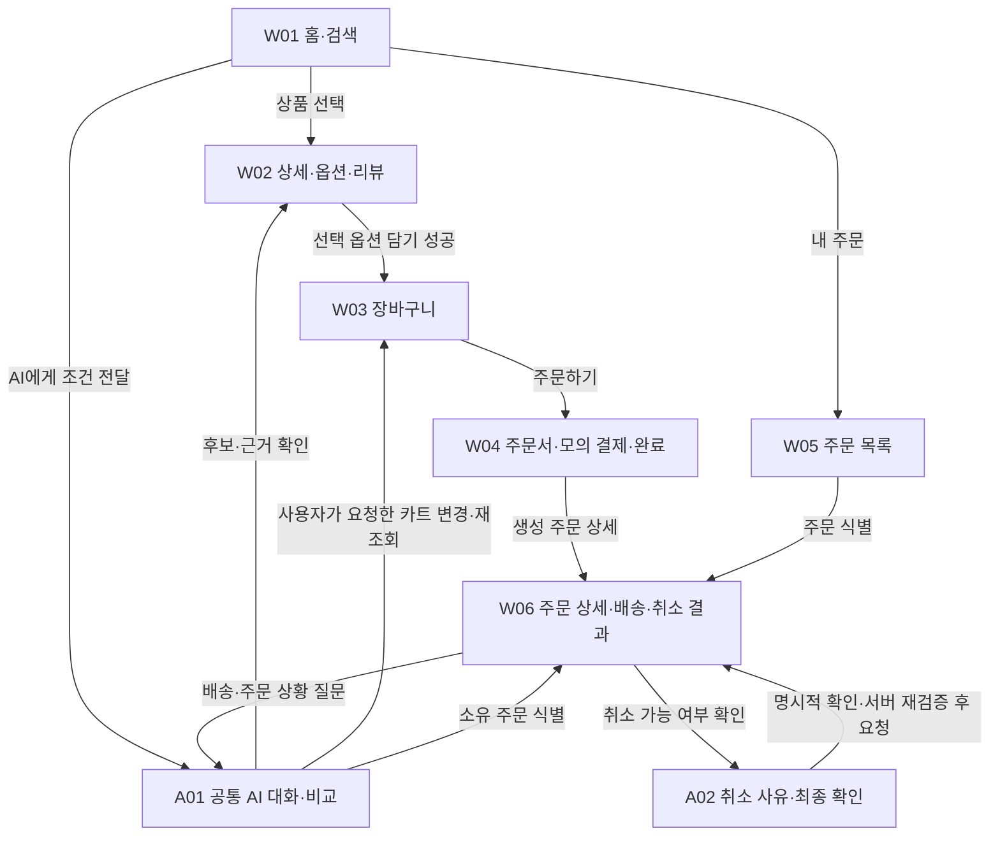

# 핵심 와이어프레임 설계 — Shopping Brain + CS Agent

> 2026-10-05 · 텍스트 와이어프레임 계획 v1. 범위 기준은 [CORE_TASK_SCOPE.md](CORE_TASK_SCOPE.md), 제품 방향은 [SHOPPING_BRAIN_VISION.md](SHOPPING_BRAIN_VISION.md)다. 아래 배치·통합·전환·실패 대응은 프로젝트 설계이며 토스 앱의 관찰 사실과 구분한다. 코드·DB 스키마·API 계약은 구현하지 않는다.

> **[2026-10-07 방향 업데이트]** W01의 '최소 홈'(검색+상품 그리드+AI 진입 행)과 "프로모션·보상 영역을 덜어낸다"는 기준은 Superseded — 현재 방향은 토스쇼핑 홈을 화면 단위 IA·콘텐츠 밀도까지 재구성하고 merchandising은 demo/static으로 재현한다(로드맵 04-B~04-C, PROJECT_CONTEXT.md §현재 프로젝트 방향). W02~W06·A01/A02의 화면 책임·Tool 연결·실패 상태 규칙은 여전히 유효하다.
>
> **[2026-10-07 우선순위]** 이 문서는 **업무 규칙·Backend 정책·사용자 Journey의 본질적 요구**의 근거로 유효하다. 반면 화면 배치·Navigation·옵션 선택 UX·Bottom Sheet·CTA 상태·Interaction·Visual 구조는 **[docs/COMMERCE_UI_SPEC.md](docs/COMMERCE_UI_SPEC.md)가 정본**이다 — 이 문서의 화면 표와 충돌하면 UI Spec과 레퍼런스 캡처를 우선한다.

## 1. 최소 화면 구성

**기본 화면 6개 + 공통 패널 2개 = 설계 단위 8개.** 패널은 별도 페이지가 아니다. 검색/홈, 옵션/리뷰, 배송/취소 결과를 각각 기존 화면 안의 상태로 통합한다. AI 추천·비교·CS는 공통 대화 패널을 사용한다.

| ID | 화면 / 패널 | 담당 범위 | 레퍼런스 |
| --- | --- | --- | --- |
| W01 | 쇼핑 홈·검색 결과 | T1 탐색 진입 | [홈 H01](reference/toss-shopping/screenshots/home/01_home_default.png), [검색 V3-03](reference/toss-shopping/screenshots/search/103_v3_search_results_default.png) |
| W02 | 상품 상세·옵션·리뷰 | T1 상품 검토·선택 | [상세 PD01](reference/toss-shopping/screenshots/product-detail/04_product_detail_default.png), [옵션 V3-16](reference/toss-shopping/screenshots/product-detail/116_v3_product_pillow_pack_default.png) |
| W03 | 장바구니 | T1 변경 결과·주문 연결 | [카트 V3-22](reference/toss-shopping/screenshots/cart/122_v3_cart_duplicate_add_quantity_two.png) |
| W04 | 최소 주문서·모의 결제·완료 | T1에서 T2/T3로 연결하는 기반 | [주문서 V2-24](reference/toss-shopping/screenshots/checkout/074_v2_checkout_from_cart_no_coupon.png), [완료 V2-27](reference/toss-shopping/screenshots/payment/077_v2_payment_order_complete.png) |
| W05 | 내 주문 목록 | T2/T3 주문 식별 | [목록 V2-29](reference/toss-shopping/screenshots/orders/079_v2_order_list_mixed_statuses.png) |
| W06 | 주문 상세·배송·취소 결과 | T2 상황 확인 / T3 처리 결과 | [상세 V2-30](reference/toss-shopping/screenshots/orders/080_v2_order_detail_paid.png); 배송 이력·최종 취소/환불은 신규 설계 |
| A01 | 공통 AI 대화·비교 패널 | T1/T2/T3의 대화·근거·행동 안내 | 신규 설계. 토스의 실제 AI 대화 화면으로 주장하지 않는다. |
| A02 | 취소 사유·최종 확인 시트 | T3 실행 전 확인 | [사유 V2-35](reference/toss-shopping/screenshots/orders/085_v2_cancel_reason_default.png), [예정액 V2-38](reference/toss-shopping/screenshots/orders/088_v2_cancel_expected_refund.png); 시트 통합은 신규 설계 |

디자인은 녹화의 다크 톤·큰 상품 이미지/가격·2열 카드·둥근 카드/버튼·파란 CTA·하단 고정 영역을 따른다. 정확한 색상·폰트·간격은 추후 정할 프로젝트 값이다. 브랜드 자산과 상품 자료는 자체/사용 가능한 자료로 구성한다. 프로모션·쿠폰·포인트·찜·판매자센터·복잡한 필터는 추가하지 않는다.

## 2. 세 과제의 연결

- **T1:** 조건 확인 → 후보/근거 비교(A01) → 옵션 확인(W02 또는 A01의 명시된 옵션) → 사용자 요청에 따른 담기 → W03의 실제 결과 확인. AI 없이 검색·선택하는 경로도 같은 데이터를 사용한다.
- **T2:** W05 또는 A01에서 내 주문 식별 → W06에서 배송 상태 조회 → A01에서 근거와 현재 상황 설명. 조회만으로 주문은 변경되지 않는다.
- **T3:** 내 주문 식별 → W06/A02의 가능 여부·예정액 확인 → A02의 사용자 최종 확인 → 요청 접수 → W06의 실제 처리 상태. 시뮬레이터 처리 후 최종 취소·모의 환불을 재조회한다.
- **연결 기반:** W03 → W04에서 사용자가 모의 결제를 직접 실행해 주문을 만든다. 배송 중/완료 등은 재현 가능한 테스트 주문도 사용한다. 결제 완료를 배송 완료로 간주하지 않는다.

## 3. 화면별 명세

### W01

| 항목 | 설계 |
| --- | --- |
| **화면명** | 쇼핑 홈·검색 결과 |
| **주요 UI** | **상단:** 검색 입력·장바구니·내 주문. **본문:** AI 도움 진입 행 → 적용 중인 검색 조건 요약 → 2열 상품 카드(이미지·상품명·가격·평점/리뷰 수). 초기 목록과 검색 결과를 같은 틀로 표시한다. |
| **필요한 데이터** | 검색어·적용 조건, 상품 ID·이미지·상품명·가격·구매 가능 여부·평점/리뷰 수, 카트 건수. |
| **사용자 Action** | 검색 실행·조건 수정·초기 목록 복귀, 상품 선택, AI 도움 열기, 카트/내 주문 이동. |
| **AI Agent Action** | A01에서 요청의 예산·용도·선호를 확인해 검색하고, 상품·리뷰를 조사해 비교 후보를 제시한다. 추천만으로 카트를 변경하지 않는다. |
| **연결 Tool** | `search_products()`; 카트 건수는 `get_cart()`. 비교 근거 조회는 A01에서 수행한다. |
| **성공/실패 상태** | Loading → 조건에 맞는 목록. **검색 결과 없음:** 검색 성공·0건을 표시하고 조건 수정 제공. **Tool 호출 실패:** 조회 실패와 재시도를 표시하며 0건으로 바꾸지 않는다. AI가 필수 조건을 임의로 완화하지 않는다. |
| **이전/다음 화면** | 이전: 앱 진입 또는 다른 화면의 쇼핑 복귀. 다음: W02 / W03 / W05 / A01. 상세에서 돌아오면 검색 조건·스크롤 위치를 유지한다. |

### W02

| 항목 | 설계 |
| --- | --- |
| **화면명** | 상품 상세·옵션·리뷰 |
| **주요 UI** | **상단:** 뒤로·카트·AI 도움. **본문:** 큰 상품 이미지 → 상품명/가격/스펙 → 옵션 선택·수량 → 배송비 → 리뷰 요약/원문 펼침. **하단 고정:** 선택 옵션·금액 요약과 담기 CTA. 옵션은 본문에 배치하고, 근거 리뷰는 해당 위치로 이동해 펼친다. |
| **필요한 데이터** | 상품/옵션 ID, 이미지·스펙·가격·재고·배송비, 선택 옵션·수량, 리뷰 ID·원문·해당 옵션·출처·근거로 사용한 항목. 팩 구성과 주문 수량은 구분한다. |
| **사용자 Action** | 옵션·수량 선택, 리뷰 원문 확인, AI에게 질문, 담기, 카트 보기. 필요한 옵션을 모두 고르기 전에는 담기 CTA를 비활성화한다. |
| **AI Agent Action** | 상품·리뷰 근거를 설명하고 모호한 옵션을 확인한다. 사용자가 상품/옵션/수량을 특정해 요청한 경우에만 담고 결과를 재조회한다. |
| **연결 Tool** | `get_product()` · `get_reviews()` · `add_to_cart()` · `get_cart()` |
| **성공/실패 상태** | 담기 성공은 저장된 카트 확인 후 피드백·카트 보기로 표시한다. **옵션 품절:** 해당 옵션 비활성·이유 표시, 임의 대체 금지. **리뷰 근거 부족:** 실사용 판단의 한계를 표시하고 확인된 스펙은 별도로 제공한다. 실행 전 가격/재고 변경은 최신 정보 확인 후 재요청하게 한다. Tool 실패/결과 미확정은 성공으로 표시하지 않는다. |
| **이전/다음 화면** | 이전: W01 / W03 / A01의 후보·근거. 다음: W03 또는 A01. 뒤로는 진입 경로를 복원하며, 옵션 선택만으로 주문서를 열지 않는다. |

> **[Superseded 2026-10-07 → UI_SPEC §7-1]** W02의 "옵션은 본문에 배치"와 "필요한 옵션을 모두 고르기 전 담기 CTA 비활성" 규칙은 폐기됐다. 현재 기준([docs/COMMERCE_UI_SPEC.md](docs/COMMERCE_UI_SPEC.md) §7-1): 진입 시 구매 가능한 기본 옵션 자동 선택, 품절 옵션은 기본 선택 제외(표시·disabled), 옵션 변경은 공용 BottomSheet, 구매 가능 옵션이 하나도 없을 때만 CTA disabled, 선택·수량 변경 시 가격/CTA 즉시 갱신.

### W03

| 항목 | 설계 |
| --- | --- |
| **화면명** | 장바구니 |
| **주요 UI** | **상단:** 뒤로·제목·AI 도움. **본문:** 상품별 이미지·옵션·단가·수량 조절·삭제. **하단 고정:** 상품 금액/배송비/합계와 주문하기. 최소 버전은 카트 전체를 주문하며 선택 결제 UI는 두지 않는다. |
| **필요한 데이터** | 사용자 카트, 항목/상품/옵션 ID, 현재 수량·가격·재고, 배송비·합계, 변경 처리 결과. 단일 판매자·단일 배송 기준을 따른다. |
| **사용자 Action** | 수량 변경·삭제, 상세 재진입, AI에게 변경 요청, 전체 상품 주문, 빈 카트에서 쇼핑 복귀. |
| **AI Agent Action** | 지칭한 상품이 모호하면 확인하고, 요청한 항목만 변경한 뒤 카트와 합계를 재조회한다. 결과를 A01과 본문에 함께 반영한다. |
| **연결 Tool** | `get_cart()` · `get_product()` · `update_cart_quantity()` · `remove_cart_item()`; 새 상품 추가 요청은 A01/W02의 담기 경로를 사용한다. |
| **성공/실패 상태** | 수량/삭제 후 목록·합계 일치. 마지막 삭제는 Empty와 쇼핑 복귀. 품절/재고 초과는 해당 항목에 표시하고 해결 전 주문 차단. 변경 중 중복 입력 차단. 실패 또는 응답 유실 시 결과 재조회 전 재변경·주문을 막고 현재 상태를 명시한다. |
| **이전/다음 화면** | 이전: W01 / W02 / A01. 다음: W02 / W04 / A01; 빈 카트는 W01. |

### W04

| 항목 | 설계 |
| --- | --- |
| **화면명** | 최소 주문서·모의 결제·완료 |
| **주요 UI** | **상단:** 뒤로·주문 확인·AI 도움. **본문:** 주문 상품/옵션/수량 → 테스트 배송지 → 상품 금액/배송비/최종 금액 → 모의 결제 안내. **하단 고정:** 금액이 명시된 모의 결제 버튼. 성공 후 같은 화면의 본문을 완료·주문 번호·주문 상세 CTA로 전환한다. |
| **필요한 데이터** | 검증된 카트·현재 금액/재고, 테스트 배송지, 사용자 확인 대상, 결제 요청 식별자·처리 상태, 생성 주문 ID·모의 결제 결과. |
| **사용자 Action** | 최종 정보 확인 후 모의 결제 직접 실행, 카트로 복귀, 완료 후 주문 상세 보기. 처리 미확정 시 동일 요청의 결과 확인. |
| **AI Agent Action** | 주문 내용을 설명할 수 있으나 결제·주문 생성을 대신 실행하지 않는다. 성공 답변은 실제 생성 주문 확인 뒤에만 제공한다. |
| **연결 Tool** | `get_cart()` · 생성된 주문의 `get_order()`. 모의 결제/주문 생성·요청별 결과 조회는 **사용자 전용 내부 동작**이며 Agent Tool로 노출하지 않는다. 내부 계약은 후속 설계에서 정한다. |
| **성공/실패 상태** | 사용자 확인 → Processing(중복 실행 차단) → 완료. 가격/재고가 달라지면 결제 전 재확인 또는 W03 수정. 실패/결과 미확정은 완료로 표시하지 않고 결과 확인을 제공한다. 서버에서 미생성을 확인한 경우에만 재시도하며, 새로고침·뒤로가기가 주문을 다시 만들지 않는다. |
| **이전/다음 화면** | 이전: W03. 다음: W06의 생성 주문 또는 W01. 결제·완료를 별도 페이지로 분리하지 않는다. |

### W05

| 항목 | 설계 |
| --- | --- |
| **화면명** | 내 주문 목록 |
| **주요 UI** | **상단:** 뒤로·내 주문·AI 도움. **본문:** 주문일·주문 번호·대표 상품/옵션·금액·현재 상태가 있는 카드와 상세 보기. |
| **필요한 데이터** | 현재 사용자, 소유 주문 ID·주문일·상품 요약·금액·상태. Agent가 언급한 후보 주문과 선택 대상. |
| **사용자 Action** | 주문 선택, AI에게 배송/취소 질문, 주문이 없으면 쇼핑으로 이동. |
| **AI Agent Action** | 소유 주문 목록으로 대상을 식별한다. “최근 산 것”처럼 여러 후보가 가능하면 날짜·상품 정보를 제시하고 선택받는다. 추측한 주문으로 취소를 진행하지 않는다. |
| **연결 Tool** | `list_orders()` · `get_order()` |
| **성공/실패 상태** | 목록 조회·올바른 주문 선택. Empty는 주문 없음과 W01 진입. Tool 실패는 재시도. 타인 주문/잘못된 ID는 접근을 막고 소유 목록에서 다시 선택하게 한다. |
| **이전/다음 화면** | 이전: W01 또는 A01의 주문 선택 안내. 다음: W06 / A01; Empty는 W01. 별도 내 정보 대시보드는 만들지 않는다. |

### W06

| 항목 | 설계 |
| --- | --- |
| **화면명** | 주문 상세·배송·취소 결과 |
| **주요 UI** | **상단:** 뒤로·주문 번호/일시. **본문:** 주문 상품/옵션·금액 → 주문/결제 상태 → 배송 상태·간단한 사건 이력·갱신 시각 → 취소 요청/환불 상태(해당 시). **행동 영역:** AI에게 이 주문 질문, 상태 새로고침, 취소 확인 또는 불가 사유. |
| **필요한 데이터** | 소유 주문, 상품/옵션·실결제액, 구분된 주문/결제/배송/취소/환불 상태, 배송 사건·시각·조회 시각, 기록된 예상일, 취소 가능 여부·사유, 취소 요청 ID와 현재 처리 결과. |
| **사용자 Action** | 배송 이력·상태 확인, 갱신, AI 설명 요청, 취소 확인 진입, 목록 복귀. |
| **AI Agent Action** | 현재 주문을 다시 조회해 준비/이동/완료를 설명한다. 데이터에 없는 도착일은 단정하지 않는다. 취소는 가능 여부 확인 후 A02로 안내하고, 요청 접수·취소 완료·모의 환불 완료를 구분해 설명한다. |
| **연결 Tool** | `get_order()` · `get_shipping_status()` · `check_cancel_eligibility()` |
| **성공/실패 상태** | 화면·AI 설명·저장 상태 일치. **배송 정보 없음:** 정보 미등록/확인 불가와 갱신 제공. 조회 실패와 실제 배송 지연은 별도 표시. **취소 불가:** 이유와 비활성 실행 UI. 취소 접수 후 중복 취소 CTA를 제거하고 처리 상태 확인을 제공한다. 최종 취소·환불은 시뮬레이터 결과를 조회한 뒤 갱신한다. |
| **이전/다음 화면** | 이전: W05 / W04 완료 / A01의 주문 선택. 다음: A01 / A02 / W05. 배송 이력과 취소·환불 결과를 별도 화면으로 만들지 않는다. |

### A01

| 항목 | 설계 |
| --- | --- |
| **화면명** | 공통 AI 대화·비교 패널 |
| **주요 UI** | 호출 화면 위의 확장형 패널. **상단:** AI 표시·현재 상품/주문·닫기. **본문:** 대화 → 현재 조건 요약 → 최대 3개 후보 비교 카드 또는 주문 설명 → 원문/상세 링크·처리 결과. **하단:** 메시지 입력. 목적별 비교와 부족한 근거를 같은 카드에서 표시한다. |
| **필요한 데이터** | 현재 대화의 조건과 메시지, 진입 화면·선택 상품/옵션/주문, Tool 처리 상태, 후보 상품·리뷰 근거 ID, 실제 카트/주문 결과. 장기 기억·Shopping Plan 저장은 요구하지 않는다. |
| **사용자 Action** | 조건 전달·수정, 추가 질문에 답하기, 후보/리뷰 근거 열기, 명확한 옵션·수량으로 담기/변경 요청, 소유 주문 선택, 취소 의사 전달, 닫기. |
| **AI Agent Action** | 현재 맥락 확인 → 필요한 조회 → 근거 비교/상황 설명 → 사용자가 요청한 허용 행동 → 실제 결과 확인. 상품/옵션/주문이 모호하면 질문한다. 취소 의사만 받았을 때는 조회·확인 화면 준비까지만 한다. |
| **연결 Tool** | T1: `search_products()` · `get_product()` · `get_reviews()` · `get_cart()` · `add_to_cart()` · `update_cart_quantity()` · `remove_cart_item()`. T2/T3 준비: `list_orders()` · `get_order()` · `get_shipping_status()` · `check_cancel_eligibility()` · `get_cancel_quote()`. 취소 실행은 A02의 확인을 거친 경로에만 연결한다. |
| **성공/실패 상태** | 확인 질문 → 조회 중 → 근거 있는 답변/실행 결과. 검색 0건·근거 부족·Tool 실패·배송 정보 없음·취소 불가를 각각 명시한다. 실패한 도구의 결과를 추정해 답하지 않는다. 단순 추천 요청은 쓰기 Tool 호출 0회, 사용자 확인 전 취소 실행도 0회여야 한다. |
| **이전/다음 화면** | 이전: W01~W06의 AI 진입. 다음: 후보/근거는 W02, 카트 결과는 W03, 식별한 주문은 W06. 취소 요청은 W06의 대상 주문을 보여준 뒤 A02를 연다. 닫기는 진입 화면을 복원한다. |

### A02

| 항목 | 설계 |
| --- | --- |
| **화면명** | 취소 사유·최종 확인 시트 |
| **주요 UI** | W06 위의 Bottom Sheet. **상단:** 취소 확인·닫기. **본문:** 주문 번호/대상 상품 → 전체 취소 안내 → 사유 선택 → 서버가 확인한 가능 여부·환불 예정액. **하단 고정:** 돌아가기 / 이 주문 취소 요청. 사유·대상·금액·자격 확인 전 실행 버튼은 비활성화한다. |
| **필요한 데이터** | 소유 주문 ID·상품·실결제액, 취소 사유, 가능 여부·불가 사유, 최신 환불 예정액과 확인 대상, 사용자 확인 여부, 요청 식별자·접수 결과. |
| **사용자 Action** | 사유 선택, 대상·환불 예정액 검토, **최종 확인 버튼으로 실행 승인**, 돌아가기/닫기. 시트를 여는 행동이나 대화의 “취소해줘”만으로 실행하지 않는다. |
| **AI Agent Action** | 가능 여부·예정액·처리 단계를 설명한다. 확인 전에는 조회만 수행한다. 명시적 확인 후 서버 검증을 통과한 동일 대상의 요청만 실행 경로에 전달하고 실제 결과를 확인한다. |
| **연결 Tool** | `check_cancel_eligibility()` → `get_cancel_quote()` → **사용자 확인·서버 검증 이후에만** `request_cancel_order()` → `get_order()`. 확인 없는 직접 Tool 호출도 서버에서 거부해야 한다. |
| **성공/실패 상태** | 조회 중 → 확인 가능 → 실행 중 → 요청 접수 후 W06. 취소 불가/조회 실패는 실행 차단. 대상·사유·금액·상태가 달라지면 기존 확인을 해제하고 재확인한다. 응답 유실은 결과 미확정으로 두고 같은 요청을 조회한다. 시트를 닫아도 이미 접수된 요청이 철회되는 것은 아니다. |
| **이전/다음 화면** | 이전: W06 또는 A01에서 W06으로 이동한 취소 흐름. 다음: W06의 요청/최종 처리 상태. 확인 전 닫기는 W06 복귀·변경 없음. |

## 4. 필수 상태의 위치와 복구 경로

| 필수 상태 | 표시 위치 | 사용자에게 제공할 다음 행동 | Agent/처리 기준 |
| --- | --- | --- | --- |
| 검색 결과 없음 | W01·A01 | 조건 수정·다시 검색 | 0건과 조회 실패를 구분하고 필수 조건을 임의 변경하지 않음 |
| 리뷰 근거 부족 | W02·A01 | 확인 가능한 원문/스펙 보기·다른 후보 검토 | 근거 없는 실사용 평가를 생성하지 않음 |
| 옵션 품절 | W02·W03·A01 | 다른 옵션 직접 선택·항목 삭제/수정 | 담기/주문 차단·무단 대체 금지 |
| Tool 호출 실패 | 해당 화면·A01 | 읽기 재시도; 변경 요청은 먼저 처리 결과 확인 | 실패를 Empty/성공으로 바꾸지 않고 중복 실행 방지 |
| 배송 정보 없음 | W06·A01 | 상태 갱신·다른 소유 주문 선택 | 미등록/조회 실패/실제 지연을 구분·도착일 추측 금지 |
| 취소 불가 | W06·A02·A01 | 사유 확인·주문 상세 복귀 | 현재 정책의 서버 판단을 따르고 실행 차단 |
| 사용자 확인 전 실행 방지 | A02, A01의 취소 안내 | 대상·예정액 확인 후 최종 버튼 또는 돌아가기 | 미확인 상태에서는 취소 실행 Tool 호출 0회; 서버도 거부 |

## 5. 공통 동작과 설계 경계

- **패널과 이동:** 한 번에 하나의 패널만 연다. A01에서 취소로 이동하면 대화를 보존하고 A01을 닫은 뒤 W06/A02를 보여준다. 패널의 뒤로/닫기는 패널만 닫고 원래 화면의 위치를 복원한다. 비교·리뷰 원문을 보고 돌아오면 대화 맥락을 유지한다. 이는 현재 세션의 유지이며 장기 기억 기능이 아니다.
- **실행 결과:** 화면 버튼과 Agent는 같은 업무 규칙·저장 데이터를 사용한다. 읽기는 Loading/성공/Empty/Error, 변경은 확인 필요/진행 중/성공/실패/결과 미확정을 구분한다. 요청 대상이 바뀌면 이전 확인을 재사용하지 않는다. 서버의 권한·최신 상태·중복 요청 검증은 후속 계약에 포함해야 한다.
- **취소 정책:** CORE_TASK_SCOPE의 모의 결제 완료·출고 전·미취소 주문 전체 취소, 실결제액 환불 규칙을 유지한다. 부분 취소·반품·교환은 이번 화면에 넣지 않는다. 요청 접수와 최종 취소/환불은 별도 값으로 보여준다.
- **평가 연결:** T1은 조건/근거와 카트의 상품·옵션·수량·금액 일치, T2는 소유 주문·배송 데이터와 설명 일치, T3는 확인된 요청 1건·단계별 상태 일치를 확인한다. 위 7개 상태도 정상 경로와 함께 검증할 시나리오다. 이 문서는 실행 테스트 결과를 주장하지 않는다.
- **레퍼런스 사용:** [UI 패턴](reference/toss-shopping/docs/UI_PATTERNS.md), [관찰 Flow](reference/toss-shopping/docs/SHOPPING_FLOW.md), [화면 인벤토리](reference/toss-shopping/docs/SCREEN_INVENTORY.md)를 참고한다. 실제 배송 이력·최종 취소/환불·정상 AI 대화·일부 실패 동작의 미관찰 판정은 유지한다. 영상 속 개인정보는 새 화면의 예시 데이터로 옮기지 않는다.

다음 단계에서는 이 6개 화면·2개 패널의 대표 배치를 시각화하고, 필요한 데이터·상태가 흐름과 맞는지 확인한 뒤 DB/Tool 상세 계약으로 연결한다. 상품군·실제 데이터 출처·디자인 토큰·기술 스택은 이 문서에서 새로 확정하지 않는다.
