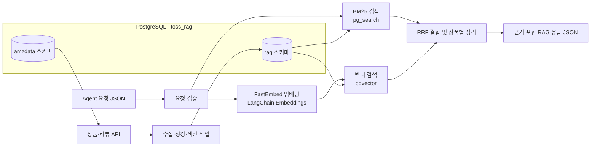

# Amazon Reviews 하이브리드 RAG 검색 설계

**작성일:** 2026-10-14
**상태:** 사용자 승인 (2026-10-15)
**관련 설계:** [Amazon Reviews API와 RAG 데이터 경계](2026-10-14-amazon-reviews-api-design.md), [PostgreSQL 저장소 설계](2026-10-14-amazon-reviews-postgresql-design.md)

## 1. 배경과 목표

Agent는 자연어 질문을 검색 요청 JSON으로 바꾸고, RAG는 상품·리뷰 원문에서 관련 후보와 근거를 반환한다. Agent는 반환된 근거와 자체 추천 정책을 바탕으로 최종 답변을 만든다. RAG는 사용자에게 답변을 생성하거나 추천 정책을 결정하지 않는다.

현재 선별 데이터는 Amazon Reviews'23의 상품 30,000개와 리뷰 178,335개로 구성된다. 상품과 리뷰는 `category`, `parent_asin`으로 연결되고, 원본 리뷰 ID가 없어 API 적재기가 만든 안정적인 `review_key`를 사용한다. 원본 상품·리뷰는 PostgreSQL `toss_rag` 데이터베이스의 `amzdata` 스키마에 두고, RAG 검색 인덱스는 같은 데이터베이스의 `rag` 스키마에 둔다. RAG 수집기는 기존 API 계약으로 원본을 읽고 PostgreSQL에는 `rag` 스키마만 기록한다. 이 문서는 PostgreSQL 저장소 설계를 확장해 RAG 테이블과 검색 확장을 추가하며, 원본 API 응답 계약은 변경하지 않는다.

이번 설계의 목표는 다음과 같다.

1. PostgreSQL에서 BM25와 벡터 검색을 함께 실행한다.
2. LangChain과 FastEmbed를 사용해 검색 흐름을 구성한다.
3. 상품 후보마다 실제 원본과 대조할 수 있는 근거를 반환한다.
4. Agent 요청·RAG 응답 계약과 동일한 샘플 JSON을 정의한다.
5. 공통 질문과 원본 일치 검사로 검색 품질과 오류 처리를 확인한다.

## 2. 범위와 제외 항목

포함:

- Agent → RAG 요청 검증
- API에서의 데이터 수집, 문서화된 청킹과 PostgreSQL 색인
- BM25 + FastEmbed dense 벡터 하이브리드 검색
- RRF 순위 결합, 중복 상품 정리, 근거 반환
- 관련 결과 없음·관련성 부족·실행 오류의 상태 구분
- 검색 평가 질문과 원본 출처 대조
- 실행 설정, 샘플 JSON, 실행 절차, 알려진 제한 문서화

제외:

- LLM 답변 생성, Agent의 자연어 조건 해석 및 추가 질문 판단
- LLM 질문 재작성, 자동 번역, 재랭커
- 평점·리뷰 수에 따른 추천 또는 제외 정책
- 원본 API 경로·응답 계약·인증 변경
- `codyssey-final-toss-backend`의 코드 변경

## 3. 아키텍처



원본 `amzdata`와 RAG 소유 데이터 `rag`는 같은 PostgreSQL 서버와 `toss_rag` 데이터베이스 안에서 스키마 및 권한으로 분리한다. API는 `amzdata`를 조회하고, RAG 수집기는 기존 API로 원본을 읽은 뒤 전용 DB 계정으로 `rag` 스키마에 기록한다. RAG 계정에는 `amzdata` 직접 접근 권한을 주지 않는다. PostgreSQL은 `pgvector` 확장으로 dense 벡터 검색을, ParadeDB의 `pg_search` 확장으로 BM25 색인을 제공한다. `pg_search`는 BM25와 토크나이저를 제공하며, 현재 확장 문서는 PostgreSQL 15–18 지원을 안내한다. `pgvector` 타입을 사용하므로 두 확장을 `toss_rag` 데이터베이스에 설치한다. PostgreSQL 버전은 기존 PostgreSQL 저장소 설계 및 구현 계획을 따르고, 확장 버전과 배포 이미지는 RAG 구현 계획에서 고정한다. ([pg_search README](https://github.com/paradedb/paradedb/blob/main/pg_search/README.md), [ParadeDB 토크나이저 안내](https://www.paradedb.com/docs/reference/tokenizers/overview))

LangChain은 FastEmbed 임베딩 어댑터와 LangChain Core의 `Document`·`BaseRetriever` 인터페이스에 사용한다. 이 설계의 근거 메타데이터와 출처 검증을 보존하기 위해 테이블과 BM25·벡터·RRF 쿼리는 프로젝트가 소유하는 PostgreSQL 스키마와 SQL로 구현한다. Qdrant 전용 저장소 연동이나 LangChain이 자동 생성하는 기본 vector store 테이블은 사용하지 않는다. ([LangChain FastEmbedEmbeddings](https://reference.langchain.com/python/langchain-community/embeddings/fastembed/FastEmbedEmbeddings), [LangChain Core Retriever](https://reference.langchain.com/python/langchain-core/vectorstores/base))

## 4. 데이터 수집과 청킹

### 4.1 원본 수집

수집기는 읽기 전용 API의 카테고리·상품·리뷰 페이지를 순회한다. 각 페이지의 `dataset_version`을 저장하고, 색인 중 버전이 바뀌면 현재 적재를 완료된 것으로 표시하지 않는다. 상품과 리뷰는 `(category, parent_asin)`으로 연결하고, 리뷰는 API가 반환하는 `review_key`로 식별한다. `user_id`는 색인하지 않는다.

수집기는 원본 PostgreSQL 테이블에 직접 연결하지 않고 API를 통해 가져온다. API가 `amzdata`의 데이터를 제공하고, 색인 작업은 전용 RAG 계정으로 `rag` 스키마를 갱신한다. 색인은 동일한 데이터셋 버전·임베딩 모델·청킹 버전에서 반복 실행해도 중복 문서가 생기지 않도록 안정적인 청크 키를 사용한다.

### 4.2 DB → RAG 정규화 레코드 예시

수집기는 API의 paginated product/review 항목을 `(category, parent_asin)`으로 결합해 다음 내부 입력 레코드로 정규화한다. 아래는 현재 로컬 샘플에서 읽은 실제 필드 예시이며, API의 페이지 envelope를 대체하는 외부 계약은 아니다. `price`에 숫자 `86.49`가 있어도 통화는 원본에 명시되지 않아 통화를 추정하지 않는다.

```json
{
  "dataset_version": "amazon-reviews-2023:seed=20261014:processed_at=2026-10-14T10:41:15.143181+00:00",
  "category": "Appliances",
  "product": {
    "parent_asin": "9792284354",
    "title": "Lascar EL-USB-RT Temperature Humidity and Dew Point USB Sensor",
    "price": 86.49,
    "average_rating": 3.2,
    "rating_number": 5
  },
  "review": {
    "review_key": "130ad24f3c248563b32bf13b490f9ab692d30358a52457173be5a921ee7e886d",
    "parent_asin": "9792284354",
    "rating": 4.0,
    "title": "expensive, but it works",
    "text": "I can't believe a freaking temperature/humidity monitor costs this much.  But it does work.  There's code on github to make it work with linux, and that works pretty well."
  }
}
```

위 레코드에서 생성하는 리뷰 근거 청크 예시다. 오프셋은 `review.text` 기준이며, `evidence_text`는 실제 원문 전체와 일치한다. 벡터 값 자체는 PostgreSQL `vector` 열에 저장하므로 JSON 예시에서는 생략한다.

```json
{
  "chunk_id": "<generated-stable-chunk-id>",
  "dataset_version": "amazon-reviews-2023:seed=20261014:processed_at=2026-10-14T10:41:15.143181+00:00",
  "category": "Appliances",
  "product_id": "9792284354",
  "source_type": "review",
  "source_id": "130ad24f3c248563b32bf13b490f9ab692d30358a52457173be5a921ee7e886d",
  "source_field": "text",
  "start_offset": 0,
  "end_offset": 171,
  "evidence_text": "I can't believe a freaking temperature/humidity monitor costs this much.  But it does work.  There's code on github to make it work with linux, and that works pretty well.",
  "embedding_text": "Lascar EL-USB-RT Temperature Humidity and Dew Point USB Sensor\nexpensive, but it works\nI can't believe a freaking temperature/humidity monitor costs this much.  But it does work.  There's code on github to make it work with linux, and that works pretty well.",
  "source_metadata": {
    "rating": 4.0
  },
  "embedding_model": "sentence-transformers/paraphrase-multilingual-MiniLM-L12-v2",
  "chunker_version": "v1"
}
```

### 4.3 검색 문서 단위

- 상품 제목, 개별 feature, 개별 description 항목은 상품 하나 안에서 의미 단위로 색인한다.
- 상품 `details`의 각 키·값도 상품 하나의 검색 문맥으로 색인한다. 키 이름은 검색용 `embedding_text`에 포함하고, 반환 `evidence_text`는 원본 값에서 추출한다.
- 리뷰 제목과 리뷰 본문은 원본 리뷰 하나를 기본 단위로 색인한다. 길이가 모델 입력 한도를 넘으면 문장·문단 경계에서 분할한다.
- 서로 다른 상품 또는 리뷰를 한 청크로 섞지 않는다.
- 청크에는 원문 필드 경로와 반개구간 오프셋(`[start_offset, end_offset)`)을 기록한다. 오프셋은 해당 원본 문자열의 Unicode 문자 인덱스다.
- 검색용 텍스트와 반환할 근거 텍스트를 구분한다. 반환 근거는 원본 필드에서 그대로 잘라낸 문자열이며 LLM 요약문이 아니다.

### 4.4 초기 임베딩 모델

FastEmbed의 `sentence-transformers/paraphrase-multilingual-MiniLM-L12-v2`를 초기 다국어 dense 임베딩 후보로 사용한다. FastEmbed 모델 목록은 이 모델을 다국어, 384차원 모델로 안내한다. 모델은 한국어 검색어와 영어 원문 사이의 검색 품질을 공통 질문으로 측정한다. 품질이 합의한 기준에 못 미치면 색인 데이터와 함께 다른 FastEmbed 다국어 모델을 평가한다. 모델명과 버전은 모든 청크와 색인 메타데이터에 기록한다. ([FastEmbed 지원 모델](https://qdrant.github.io/fastembed/examples/Supported_Models/))

## 5. PostgreSQL 검색 저장소

상품별 반환 메타데이터와 근거 청크를 분리해 `rag.indexed_products`와 `rag.evidence_chunks` 두 테이블에 저장한다. 상품 테이블의 기본 키는 `(dataset_version, category, product_id)`다. `product_payload`에는 API가 반환한 상품 필드를 JSONB로 보존한다. 가격 비교를 위해 파싱한 값과 통화는 원본에 명시적으로 근거가 있을 때만 별도 nullable 열에 둔다.

`rag.evidence_chunks`는 최소한 다음 필드를 보유한다.

| 필드 | 의미 |
|---|---|
| `chunk_id` | 원본 ID, 원본 필드, 오프셋, 데이터셋 버전, 청킹 버전으로 결정하는 안정적인 청크 ID |
| `dataset_version` | 원본 API에서 받은 데이터셋 버전 |
| `category` | 원본 카테고리 키 |
| `product_id` | Amazon `parent_asin` |
| `source_type` | `product` 또는 `review` |
| `source_id` | 상품 청크는 `parent_asin`, 리뷰 청크는 `review_key` |
| `source_field` | 예: `title`, `features[0]`, `description[1]`, `text` |
| `start_offset`, `end_offset` | 원본 필드 안에서 근거가 차지하는 문자 위치 |
| `evidence_text` | 원본 필드에서 그대로 추출한 근거 문자열 |
| `embedding_text` | 임베딩과 BM25에 사용하는 검색 문자열 |
| `source_metadata` | 리뷰면 `rating`, `timestamp`, `helpful_vote`, `verified_purchase` 등 원본 리뷰 메타데이터 |
| `embedding` | FastEmbed dense 벡터 |
| `embedding_model` | 임베딩 모델 식별자와 버전 |
| `chunker_version` | 청킹 규칙 버전 |
| `product_id` | `dataset_version`, `category`와 함께 `rag.indexed_products`의 복합 키를 참조 |

`rag.indexed_products`는 최소한 다음 필드를 보유한다.

| 필드 | 의미 |
|---|---|
| `dataset_version`, `category`, `product_id` | API 스냅샷과 상품을 식별하는 복합 기본 키 |
| `product_payload` | 원본 상품 응답의 JSONB 스냅샷. 응답에 필요한 `title`, `price`, `average_rating`, `rating_number` 등을 원래 필드명으로 보존 |
| `price_amount`, `price_currency` | 원본에 비교 가능한 숫자·통화가 명확할 때만 채우는 정규화 열. 알 수 없으면 `NULL` |

`embedding_text`에는 `pg_search` BM25 인덱스를 둔다. dense 검색은 pgvector cosine 거리의 정확 검색으로 시작하고, 측정한 지연 시간이 필요할 때 HNSW 같은 근사 인덱스를 추가한다. `category`, `product_id`, `dataset_version`, `source_type`에는 관계 조회·필터에 필요한 일반 B-tree 인덱스를 둔다. `pg_search` 문서는 Lindera 등 한국어를 포함한 CJK 토크나이저를 제공한다. 다만 현재 원본 텍스트는 주로 영어이므로 한국어 형태소 분석만으로 한국어 단어와 영어 원문이 일치하지는 않는다. ([토크나이저 안내](https://www.paradedb.com/docs/reference/tokenizers/overview))

## 6. 검색 동작

1. Agent 요청 JSON의 타입, 필수값, 가격 범위, 통화를 검증한다.
2. 제공된 `query`를 FastEmbed로 임베딩한다. RAG는 질문을 LLM으로 재작성하거나 번역하지 않는다.
3. `query`와 요청 조건을 이용해 BM25 검색 및 cosine 벡터 검색을 각각 수행한다. 두 검색은 같은 상품끼리 합치기 전에 독립된 순위 목록을 만든다.
4. 각 검색 목록에서 청크를 상품별로 묶고, 각 상품의 가장 높은 청크 순위를 상품 순위로 삼는다.
5. 상위 후보 목록을 Reciprocal Rank Fusion으로 결합한다. 검색 점수 스케일을 직접 더하지 않고 순위를 결합한다. BM25와 cosine 거리는 정답 확률로 취급하지 않는다. ([RRF 개념과 예시](https://www.paradedb.com/learn/search-concepts/reciprocal-rank-fusion))
6. 상위 `top_k`개의 서로 다른 상품 후보를 반환한다. 각 후보의 상품별 상위 근거는 최대 3개까지 반환하고, 같은 리뷰에서 겹치는 청크는 한 개로 정리한다. 초기 각 검색 채널의 후보 깊이는 설정값 20으로 시작하고 골든 질문 결과로 조정한다.
7. 선호 조건은 검색 맥락으로 사용할 수 있지만 필수 필터로 적용하지 않는다. 필수 조건도 구조화된 데이터로 확인할 수 없는 경우 충족한 것으로 표시하지 않고 `unverified_conditions`에 남긴다.

한국어 질문과 영어 원문 간 의미 검색은 다국어 dense 모델이 담당한다. BM25는 영어 단어, 모델명, 상품명처럼 원문과 검색어의 토큰이 겹칠 때 특히 유용하다. 한국어 단어를 영어로 자동 변환하지 않으므로, 한국어 자연어 질문과 영어 자료를 짝지은 평가로 하이브리드 결과를 확인한다.

## 7. Agent ↔ RAG 계약

### 7.1 Agent → RAG 요청

입력은 사용자가 제시한 Agent → RAG v0.1 JSON Schema를 따른다. `request_id`는 선택값이며, 사용자 질문의 민감정보는 제거하고 로그에는 본문을 기록하지 않는다. 가격 범위가 있으면 통화를 함께 전달하고, 최소 가격이 최대 가격보다 크면 요청 검증 오류로 처리한다.

예시:

```json
{
  "request_id": "REQ-DEMO-001",
  "original_question": "10만원 이하 저소음 키보드 추천해줘. 숫자패드는 꼭 있어야 하고 무선이면 좋겠어.",
  "query": "저소음 키보드 숫자패드 무선",
  "filters": {
    "price_min": null,
    "price_max": 100000,
    "currency": "KRW"
  },
  "required_conditions": [
    "상품 종류: 키보드",
    "저소음",
    "숫자패드 있음"
  ],
  "preferences": ["무선 연결"],
  "top_k": 10
}
```

### 7.2 RAG → Agent 응답

`top_k`는 최종 추천 수가 아니라 서로 다른 상품 후보 수다. 후보에는 상품 자체와 근거 배열을 포함한다. 근거에는 `product_id`, `chunk_id`, `source_type`, `source_id`, `source_field`, 원본 `dataset_version`을 담는 `source_version`, 원문 `evidence_text`, 오프셋, BM25·벡터 순위, RRF 순위를 포함한다. 리뷰 근거에는 평점·작성 시각 등 API의 원본 리뷰 메타데이터도 포함한다. RRF 점수는 정답 확률이 아니다.

```json
{
  "request_id": "REQ-DEMO-001",
  "status": "low_relevance",
  "dataset_version": "<source-dataset-version>",
  "applied_filters": {},
  "unverified_conditions": [
    "가격 상한 100000 KRW: 원본 가격에 비교 가능한 통화 정보가 없음",
    "저소음: 검색된 원문 근거로 Agent 확인 필요",
    "숫자패드 있음: 검색된 원문 근거로 Agent 확인 필요"
  ],
  "items": [],
  "error_code": null
}
```

위 저관련성 응답과 아래 후보 객체는 계약 구조 예시이며 실제 검색 순위나 관련성을 주장하지 않는다. `items`의 각 후보는 다음 구조를 따른다.

```json
{
  "product_id": "<parent_asin>",
  "category": "<source-category>",
  "product_metadata": {
    "title": "<source-title>",
    "price": "<source-price-as-provided>",
    "average_rating": null,
    "rating_number": null
  },
  "rrf_score": 0.0,
  "evidence": [
    {
      "chunk_id": "<stable-chunk-id>",
      "source_type": "review",
      "source_id": "<review_key>",
      "source_field": "text",
      "source_version": "<source-dataset-version>",
      "evidence_text": "<exact-source-substring>",
      "source_metadata": {
        "rating": 4.0,
        "verified_purchase": false
      },
      "start_offset": 0,
      "end_offset": 24,
      "bm25_rank": null,
      "vector_rank": 1,
      "rrf_rank": 1
    }
  ]
}
```

## 8. 필터 및 조건 확인

- 가격은 원본 데이터가 비교 가능한 숫자 가격과 통화를 제공할 때만 필터링한다. 현재 상품 원본은 가격 필드에 명시 통화가 없으므로 KRW 요청을 원본 숫자와 직접 비교하지 않는다. 이 조건은 `unverified_conditions`에 보고한다.
- 상품 종류, 저소음, 숫자패드, 호환성 등은 명시적인 metadata 필드가 확인된 경우에만 구조화 필터로 처리한다. 그렇지 않으면 관련 근거를 검색하고 Agent가 충족 여부를 확인한다.
- `applied_filters`에는 실제로 적용한 조건만 담는다. 검색어에 조건이 포함됐다는 사실만으로 조건을 적용했다고 표시하지 않는다.
- Agent가 `preferences`로 보낸 조건 때문에 모든 상품을 제거하지 않는다.
- Agent의 평점·리뷰 수 추천 기준은 RAG 제외 필터로 사용하지 않는다.
- 상품 원본의 `average_rating` 및 `rating_number`는 Agent가 사용할 수 있도록 원본 값을 반환하되, RAG 검색 필터나 추천 판단에는 사용하지 않는다. `rating_number`는 수집한 리뷰 청크 수와 혼동하지 않도록 원본 필드명으로 반환한다.

## 9. 상태와 오류 처리

| `status` | 의미 |
|---|---|
| `ok` | 최소 관련성 기준을 통과한 후보와 근거가 있음 |
| `no_results` | 적용 가능한 검색 범위에 검색 후보가 없음 |
| `low_relevance` | 후보 청크는 있지만 평가로 정한 관련성 기준을 통과한 결과가 없음 |
| `error` | 요청 검증 외 실행 중 임베딩, DB, 타임아웃 등의 실패 |

요청 검증 실패는 `status: "error"`, `error_code: "invalid_request"`로 반환한다. `error_code`는 운영자가 원인을 구분할 수 있는 안정된 코드로 제한하며, SQL, 연결 문자열, 스택 트레이스 등 내부 상세를 Agent 응답에 노출하지 않는다. 검색 후보가 있다는 것만으로 충분한 관련성이 있다고 판단하지 않는다. 관련성 기준은 골든 질문과 자료 없음 질문을 사용해 정하고, 튜닝 질문과 홀드아웃 검증 질문을 분리한다.

## 10. 평가와 원본 검증

공통 평가 질문에는 질문 텍스트만이 아니라 사람이 판정한 관련 `source_type`·`source_id` 및 관련 상품 ID를 연결한다. 질문 세트는 다음 유형을 포함한다.

- 원문 표현과 일치하는 직접 질문
- 한국어 자연어 질문과 영어 원문 간 다른 표현 질문
- 정확한 상품명·모델명 검색
- 비슷한 상품 사이의 출처 혼합 방지
- 긍정·부정 리뷰 근거 모두 검색
- 원본에 답이 없는 질문 및 낮은 관련성 후보
- 자료 없음, DB 오류, 임베딩 오류를 구분하는 사례

확인 기준:

1. 관련 `source_id`가 상위 상품 후보와 대표 근거에 포함되는지 측정한다.
2. `source_id`가 현재 `dataset_version`의 원본 API에서 조회되는지 확인한다.
3. 리뷰 원본의 `review_key`, `parent_asin`, `category`가 반환 상품 정보와 일치하는지 확인한다.
4. `source_field[start_offset:end_offset] == evidence_text`인지 검사한다.
5. 원본 버전이 바뀌었거나 삭제된 근거는 검색 결과에서 제외하고 재색인한다.
6. `no_results`, `low_relevance`, `error` 상태가 각각 의도한 입력에서 반환되는지 검사한다.

현재 샘플은 Appliances, Clothing, Grocery 카테고리만 포함한다. 컴퓨터 키보드 질문은 실제 긍정 검색 사례가 보장되지 않으므로, 그 예시는 우선 자료 없음 또는 낮은 관련성 처리와 미확인 조건 표시를 확인하는 데 사용한다. 긍정 검색 평가는 현재 샘플에 존재하는 상품·리뷰를 사용한다.

## 11. 실행 및 운영

- DB 접속 URL과 모델 캐시 경로는 환경 변수로 설정하고 비밀 값은 코드나 Git에 저장하지 않는다.
- 구현 설정은 `AMAZON_REVIEWS_API_BASE_URL`, `RAG_DATABASE_URL`, `RAG_EMBEDDING_MODEL`, `FASTEMBED_CACHE_PATH`로 분리한다. 기본 모델은 본 설계의 초기 후보를 사용한다.
- 데이터 수집·청킹·임베딩·색인은 명시적인 재현 가능 명령으로 실행한다. API 조회 또는 DB 작업 실패 시 부분 색인을 정상 완료로 표시하지 않는다.
- 색인에는 원본 데이터셋 버전, 청킹 버전, 임베딩 모델을 기록한다. 변경이 있으면 인덱스를 재생성한다.
- 로그에는 `request_id`, 상태, 처리 시간, 오류 코드만 기본 기록한다. 사용자 질문과 리뷰 본문은 기본 로그에서 제외한다.
- BM25 후보 깊이, 벡터 인덱스 종류, 최소 관련성 기준은 공통 평가 결과를 바탕으로 확정한다.

## 12. 알려진 제한

1. Amazon 샘플 원문은 대부분 영어다. 다국어 임베딩을 사용해도 한국어 질문의 검색 품질은 골든 질문으로 확인해야 한다.
2. BM25는 번역기가 아니다. 한국어 질의의 의미를 영어 원문에서 직접 찾는 일은 dense 검색이 주로 담당한다.
3. 현재 원본 가격에는 통화 식별 정보가 없어 KRW 조건을 정확히 적용할 수 없다.
4. 원본에 특정 기능 metadata가 없으면 근거 검색은 가능해도 필수 조건 충족을 자동 확정할 수 없다.
5. 상위 후보 수가 제한되므로, top-k 내부에 적격 상품이 없다는 결과를 전체 쇼핑몰에 그런 상품이 없다는 뜻으로 확대하지 않는다.

## 13. 관련 기술 문서

- [pg_search extension](https://github.com/paradedb/paradedb/tree/main/pg_search)
- [pgvector](https://github.com/pgvector/pgvector)
- [FastEmbed supported models](https://qdrant.github.io/fastembed/examples/Supported_Models/)
- [LangChain FastEmbed integration](https://reference.langchain.com/python/langchain-community/embeddings/fastembed/FastEmbedEmbeddings)
- [LangChain Core Retriever](https://reference.langchain.com/python/langchain-core/vectorstores/base)
- [Reciprocal Rank Fusion](https://www.paradedb.com/learn/search-concepts/reciprocal-rank-fusion)
