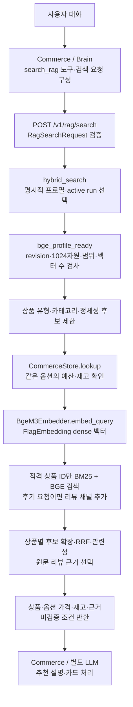

# 현재 RAG 구성 — BGE-M3 / API 0.3.1

확인: **2026-10-20 20:49 KST**. [목차](README.md) · [복구 보고서](bge-api-compat-recovery-2026-10-20.md) · [실행 증거](evidence/runtime-snapshot-2026-10-20.json)

## 1. 실행 상태

| 항목 | 확인 결과 |
|---|---|
| 모델 | **BAAI/bge-m3**, dense 1,024차원 |
| revision | `5617a9f61b028005a4858fdac845db406aefb181` |
| 입력·실행 | 최대 128토큰, CPU FlagEmbedding |
| 이미지 | `toss-ads-product-rag-service:bge-api-compat-20261020` |
| API | **0.3.1**, 기존 **8002** 포트 |
| 검색 DB | **5432/toss_rag/rag** |
| Commerce DB | **5432/toss**, test_items2 옵션 가격·재고 |
| 프로필 | 기본 **test_items2**, rag.index_profiles의 해당 active_run_id |
| 선택 run | `e925490f-4f34-4c03-9248-eb9ebdfcde48` |
| 데이터 | 상품 1,500 / 리뷰 46,100 / 청크·BGE 벡터 114,106 |
| 범주 | beauty, fashion, food, living |
| 청킹 | v2, 최대 96토큰, overlap 없음 |
| 복구 보존 | 기존 MiniLM 벡터, 이전 BGE·MiniLM 컨테이너 |

BGE 전환 때 API가 0.2 기반으로 바뀌면서 기존 요청을 거부한 문제를 복구했다. 모델·원본·청크·벡터·프로필 포인터 변경은 없었다. healthz는 이제 모델·차원·프로필·Commerce 구성 여부를 표시한다.

## 2. 현재 검색 흐름

Python API는 최종 답변 생성 LLM을 호출하지 않는다. 실제 웹/Brain E2E는 이번 복구에서 확인하지 않았다.

## 3. 실행 메서드와 역할

아래 소스는 실행 이미지와 SHA-256을 대조한 사본이다. [모듈별 출처·해시](reference-code/bge-api-compat/source-metadata.json).

| 파일 | 메서드 | 역할 |
|---|---|---|
| [api.py](reference-code/bge-api-compat/src/toss_ads/rag/api.py) | create_app, search | 설정·오류 변환, run_in_threadpool로 hybrid_search 실행 |
| [schemas.py](reference-code/bge-api-compat/src/toss_ads/rag/schemas.py) | RagSearchRequest.model_validate | profile/product_type/가격/재고 등 요청 검증 |
| [store.py](reference-code/bge-api-compat/src/toss_ads/rag/store.py) | active_run | 요청/기본 프로필의 active 포인터 선택 |
| [retriever.py](reference-code/bge-api-compat/src/toss_ads/rag/retriever.py) | bge_profile_ready | revision·전체 범위·입력 길이·실제 벡터 수 확인 |
| [commerce.py](reference-code/bge-api-compat/src/toss_ads/rag/commerce.py) | lookup | 같은 variant에서 가격·재고를 읽기 전용 검증 |
| [embeddings.py](reference-code/bge-api-compat/src/toss_ads/rag/embeddings.py) | create_embedder | BGE 자체 어댑터 또는 MiniLM FastEmbed 선택 |
| [bge_m3.py](reference-code/bge-api-compat/src/toss_ads/rag/bge_m3.py) | embed_query | FlagEmbedding BGE dense 계산 |
| [store.py](reference-code/bge-api-compat/src/toss_ads/rag/store.py) | search_bm25, search_embedding_vector | category/source_type/적격 product_ids 제한 검색 |
| [retriever.py](reference-code/bge-api-compat/src/toss_ads/rag/retriever.py) | hybrid_search | 후보·RRF·관련성·근거·Commerce 응답 결합 |

## 4. 랭킹·조건 처리

- 채널 초기 깊이 20, 적격 상품 후보 50개 목표로 최대 2,000청크까지 확장한다. 항상 50개를 보장하는 것은 아니다.
- 상품명/상품 유형·정체성 관련성 검사와 어휘 우선 정렬 후 RRF(k=60)를 사용한다.
- 예산과 재고는 **검색 전 같은 옵션 행**에서 검증하고 BM25/BGE에 적격 상품 ID만 전달한다.
- 리뷰 요청이면 전용 채널을 추가한다. REAL 우선, 중복/짧은 조각 제외, 상품별 최대 3개 근거를 선택한다.
- 반환 가격은 선택된 Commerce 옵션 가격이다. 모의값·출처 상태를 유지하며 실제 시장 가격이라고 표시하지 않는다.
- 임의 필수 스펙·용도 선호는 미검증 목록에 남는다. 배송비 포함 총액도 이 단가 필터가 자동 보장하지 않는다.

## 5. LangChain 적용

| 구성 | 현재 상태 |
|---|---|
| BGE 임베딩 | BgeM3Embedder → FlagEmbedding 직접 호출 |
| HybridRagRetriever(BaseRetriever) | BGE 객체 생성 호환, 결과를 Document로 변환 |
| HTTP 검색 | hybrid_search 직접 호출. Retriever.invoke 경유 아님 |
| MiniLM 설정 | LangChain Community FastEmbed 사용 가능 |
| 최종 LLM/Agent | 별도 계층, 챗봇 전체를 LangChain Agent라고 설명하지 않음 |

이번 복구는 HTTP를 LangChain invoke로 전환한 작업이 아니다. 예전 연결 브랜치와 현재 운영 구현을 구분한다.

## 6. 검증 범위

회귀 9/9, 후보·운영 HTTP 각각 10개 통과. 네 범주 검색·0원 예산 제외·기존 catalog/reviews를 확인했다. 옵션 15건·근거 43건을 읽기 전용 SQL로 대조했고 BGE 114,106개가 준비 상태였다. LAN·공유 HTTPS 검색도 200이었다.

연결 검사를 추천 정확도·부하 시험·브라우저/LLM E2E 성공으로 일반화하지 않는다. 0.2 strict 클라이언트는 복원된 추가 응답 필드를 허용해야 한다.
