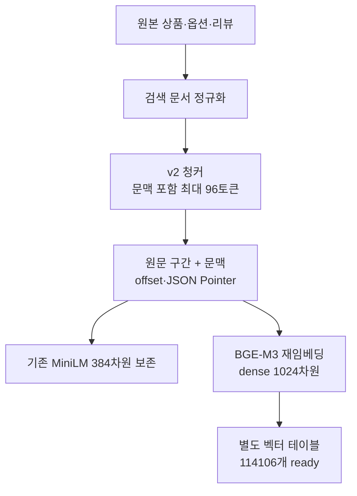

# 청킹과 임베딩 — BGE-M3 기준

[목차](README.md) · 기준: 2026-10-20 18:25 KST

## 1. 현재 설정

| 항목 | 값 |
|---|---|
| 실제 모델 | **BAAI/bge-m3** |
| revision | 5617a9f61b028005a4858fdac845db406aefb181 |
| 출력 | dense **1,024차원** |
| 호출 | 자체 BgeM3Embedder → FlagEmbedding BGEM3FlagModel |
| 실행 | CPU, use_fp16=False |
| 입력 최대 길이 | **128토큰** |
| 저장 청크 | 기존 **v2 / 최대 96토큰 / overlap 없음** |
| BGE 벡터 | **114,106개**, 네 카테고리 전체 |
| MiniLM | 기존 384차원 114,106벡터 보존 |
| sparse / ColBERT | 사용 안 함 |

BGE 적용은 **기존 embedding_text를 재사용한 재임베딩**이다. 원본 재수집·재청킹·청크 경계 변경을 수행한 전환은 아니다.

## 2. 청킹 대상

| 대상 | 내용 | 별도 메타데이터 |
|---|---|---|
| 상품 | 정규화 문서의 title, features, description, details | 상품 ID·분류·버전·원본 연결 |
| 옵션 | 색인 입력에 포함된 옵션명·설명·스펙 | variant ID·가격·재고·출처 |
| 리뷰 | 정규화 text 본문, 없으면 title | 리뷰 ID·평점·날짜·REAL/SYNTHETIC·옵션 연결 |

DB의 name/body/specs_json 등을 검색 문서 형태로 옮기는 단계와 청커를 구분한다. 이미지 URL은 메타데이터이며 이미지 임베딩 대상이 아니다.

## 3. 분할과 원문 추적

- 문장·줄바꿈·공백 경계를 우선하고 토큰 예산에 맞게 분할한다.
- 상품명·필드명 접두어도 96토큰 예산에 포함한다. 본문 96토큰에 접두어를 추가하는 방식이 아니다.
- evidence_text는 원문 구간, embedding_text는 문맥과 원문 구간이다.
- offset과 JSON Pointer를 보존한다. 청커가 요약·의역한 문장을 원문 근거로 저장하지 않는다.
- 청크 ID에는 데이터·상품·출처·필드·offset·청커/모델 등의 해시 재료가 들어간다.
- 이번 BGE 테이블은 기존 run/chunk_id를 참조한다. 청크 ID 전체를 새 모델명으로 다시 생성한 방식이 아니다.

실행 소스: [청커](../../reference-code/bge-m3/src/toss_ads/rag/chunker.py), [BGE 어댑터](../../reference-code/bge-m3/src/toss_ads/rag/bge_m3.py), [임베더 선택](../../reference-code/bge-m3/src/toss_ads/rag/embeddings.py).

## 4. BGE인데도 96토큰인 이유

96은 초기 MiniLM 색인에서 사용한 크기다. BGE 비교·전환에서는 모델 차이만 보고 기존 청크·출처를 재사용하기 위해 경계를 유지했다. 현재 BGE 호출 상한도 128토큰이다.

**BGE로 바꿨다고 청크가 자동으로 길어지지는 않는다.** 96이 최적이라는 길이 비교 실험은 발견하지 못했다. 모델의 지원 최대 길이와 현재 설정 길이를 구분해야 한다.

길이를 조정하려면 동일한 사람 검수 질의/정답에서 길이별 새 run을 만들고 재임베딩한다. 적중률·근거 완결성·지연·비용을 함께 비교한다. 다른 토크나이저에서 같은 embedding_text가 몇 토큰이 되는지도 별도 확인해야 한다. 이번 자료 갱신에서 입력 잘림이나 길이별 품질을 새로 측정하지 않았다.

## 5. v3의 상태

추천 품질 브랜치에는 관리용 필드 제외와 짧은 리뷰 꼬리 조각 병합/경계 재배분을 포함한 v3가 있다. **현재 BGE 실행 코드와 활성 청크는 v2**다.

| 구분 | 상태 |
|---|---|
| v2 기존 청크 | 현재 사용 |
| v3 청커 | 별도 추천 품질 브랜치에 보존 |
| v3 전체 재청킹·재임베딩 | 이번 BGE 전환에 미포함 |
| REAL 우선·짧은 조각 제외 | 별도 추천 품질 기능, BGE 실행본에 자동 통합된 것은 아님 |

v3 적용은 새 청킹·BGE 임베딩 범위를 함께 갱신하고 검증하는 작업이다. 코드 파일만 바꿔 저장된 v2가 바뀐 것으로 표시하지 않는다.

## 6. 모델별 위치

| 모델 | 차원 | 상태 |
|---|---:|---|
| **BGE-M3** | **1,024** | **현재 API 모델, 전체 벡터 준비** |
| MiniLM-L12-v2 | 384 | 기존 기준선·복구용 |
| multilingual-e5-large | 1,024 | 두 beauty 데이터 오프라인 비교 |
| Qwen3-Embedding-0.6B | 1,024 | 두 beauty 데이터 오프라인 비교 |
| multilingual-mpnet-base-v2 | 768 | 후보 언급, 실측 없음 |
| bge-reranker-v2-m3 | 별도 역할 | 리랭커 후보, 적용/측정 없음 |

최종 답변 LLM은 임베딩 모델과 별도다. BGE는 문서·질문을 벡터로 바꾸며 추천 문장을 생성하지 않는다.

## 7. LangChain

BGE의 embed_query/embed_documents라는 이름이 LangChain 상속이나 FastEmbed 경유를 뜻하지 않는다. 실제 계산은 FlagEmbedding이다. LangChain Retriever 어댑터는 존재하지만 HTTP는 검색 함수를 직접 호출한다.

준비 상태는 [실행 증거](runtime-snapshot-2026-10-20.json), 품질/비용은 [모델 비교](model-comparisons-and-evaluation.md)를 참조한다.
