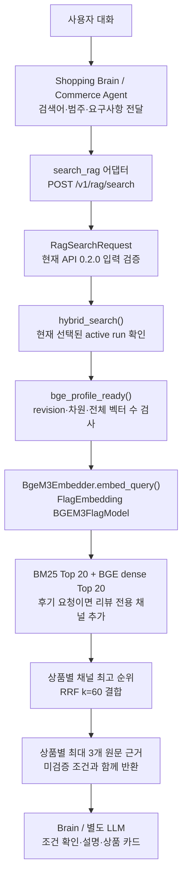

# 현재 RAG 구성 — BGE-M3 운영 기준

확인 시각: **2026-10-20 18:25 KST**. [통합 목차](README.md) · [실행 증거](runtime-snapshot-2026-10-20.json)

## 1. 실제 실행 상태

| 항목 | 확인 결과 |
|---|---|
| 모델 | **BAAI/bge-m3**, dense **1,024차원** |
| revision | `5617a9f61b028005a4858fdac845db406aefb181` |
| 입력 상한·실행 | 128토큰, CPU FlagEmbedding |
| 검색 | **BM25 + BGE-M3 dense → 상품별 RRF(k=60)** |
| 컨테이너 | product-rag-api, running |
| 이미지 | toss-ads-product-rag-service:rag-bge-m3-full-test-items2-252bc90 |
| API | http://127.0.0.1:8002, POST /v1/rag/search, **버전 0.2.0** |
| 검색 DB | **5432 / toss_rag / rag** |
| 데이터 | test_items2, 1,500상품 / 46,100리뷰 / 114,106청크 |
| 선택 run | e925490f-4f34-4c03-9248-eb9ebdfcde48 |
| BGE 프로필 | scope=*, status=ready, **114,106벡터** |
| 범주 | beauty, fashion, food, living |
| 청킹 | 기존 v2 / 최대 96토큰 / overlap 없음 |
| MiniLM | 기존 384차원 114,106벡터는 복구용 보존 |

14:47 KST의 이전 자료는 MiniLM 실행을 기록했다. 이후 전체 BGE 적재·전환 기록이 생겼고, 이번 재확인에서도 BGE 실행 설정과 전체 벡터 수를 확인했다. 이번 문서 갱신 자체가 모델을 전환한 것은 아니다.

healthz는 HTTP 200, status=ok와 test_items2 버전·네 범주를 반환했다. 모델명은 healthz 응답에 직접 나오지 않으므로 컨테이너 설정·실행 코드·DB 프로필을 함께 확인했다.

## 2. 현재 검색 흐름

이번 확인은 RAG API·실행 소스·DB 메타데이터 범위다. Brain/웹/최종 LLM까지의 E2E나 새 검색 품질 평가를 실행하지 않았다. 이 API 자체는 답변 생성 LLM을 호출하지 않는다.

## 3. 메서드와 역할

문서 브랜치의 과거 src와 혼동하지 않도록 **실행 컨테이너에서 읽은 소스 사본**에 연결했다.

| 파일 | 메서드 | 역할 |
|---|---|---|
| [api.py](../../reference-code/bge-m3/src/toss_ads/rag/api.py) | create_app, 검색 핸들러 | 모델/DB 구성, 검증, hybrid_search 직접 호출, HTTP 오류 변환 |
| [schemas.py](../../reference-code/bge-m3/src/toss_ads/rag/schemas.py) | RagSearchRequest.model_validate | 원문·query·category·가격 요청 형식·top_k 검증 |
| [embeddings.py](../../reference-code/bge-m3/src/toss_ads/rag/embeddings.py) | create_embedder | BGE이면 자체 어댑터, MiniLM이면 FastEmbed 생성 |
| [bge_m3.py](../../reference-code/bge-m3/src/toss_ads/rag/bge_m3.py) | embed_query, embed_documents | 고정 revision의 FlagEmbedding dense 계산. sparse/ColBERT 비활성 |
| [retriever.py](../../reference-code/bge-m3/src/toss_ads/rag/retriever.py) | bge_profile_ready | 전체 범위·ready·차원·입력 길이·revision·실제 벡터 수 검사 |
| [store.py](../../reference-code/bge-m3/src/toss_ads/rag/store.py) | active_run | active 중 완료/시작 시각 기준 최신 run 선택 |
| [store.py](../../reference-code/bge-m3/src/toss_ads/rag/store.py) | search_bm25, search_embedding_vector | ParadeDB BM25와 별도 BGE 벡터 테이블 검색 |
| [retriever.py](../../reference-code/bge-m3/src/toss_ads/rag/retriever.py) | hybrid_search | 채널 결합·상품 RRF·원문 근거 선택 |

소스 출처/해시: [실행 소스 메타데이터](../../reference-code/bge-m3/source-metadata.json).

## 4. 랭킹·조건 처리의 실제 범위

| 항목 | 현재 BGE 실행본 |
|---|---|
| 채널 깊이 | 각 채널 **20청크**. 50개 서로 다른 상품 확보 방식은 아님 |
| RRF | 상품별 각 채널 최고 청크 순위의 1/(60+rank) 합 |
| 동점 | category, product_id로 정렬 |
| 리뷰 요청 | 후기/리뷰/사용평 표현이면 리뷰 BM25·dense 추가 |
| 최종 수 | top_k 기본 10, 허용 1~20 |
| 근거 | 상품당 최대 3청크. 원문·source_id·offset·source_metadata |
| 최소 관련성 점수 | 현재 min_rrf_score=null |
| 가격·재고 | **현재 Python BGE 경로에 Commerce 옵션 가격/재고 하드 필터 없음** |
| 상품 유형·어휘 우선 | 추천 품질 브랜치의 유형 게이트·어휘 정렬은 현재 BGE 소스에 미통합 |
| 필수 조건 | 가격 범위·임의 필수/선호를 unverified_conditions로 반환 |
| 리뷰 선별 | 추천 품질 브랜치의 REAL 우선·리뷰 중복 제거·짧은 조각 제외는 자동 통합된 것이 아님 |

BGE 전환은 확인됐지만 **가격 검증 → 용도에 가까운 리뷰 → 필수 옵션 미달 제외**의 전체 흐름은 별도 통합 과제다. 가격 필드가 스키마에 있다는 것만으로 필터가 적용됐다고 표시하지 않는다.

## 5. LangChain 적용 위치

| 구성 | 현재 BGE 실행 경로 |
|---|---|
| BGE 임베딩 | 자체 BgeM3Embedder → FlagEmbedding. **FastEmbedEmbeddings 경유 아님** |
| HybridRagRetriever(BaseRetriever) | 소스에 존재, Document 변환용 어댑터 |
| HTTP 검색 | hybrid_search 직접 호출, Retriever.invoke 경유 아님 |
| MiniLM 복구 경로 | LangChain Community FastEmbed 사용 가능 |
| 10/18 HTTP 연결 브랜치 | search(request) → invoke 구현·검증이 별도로 보존됨 |
| 대화/LLM | 별도 계층. Python 서비스 전체가 LangChain Agent인 것은 아님 |

새 구성도에서 BGE 계산을 LangChain FastEmbed로 표시하지 않는다. [과거 LangChain 구성도](../../archive/langchain-http/deploy/product-rag-runtime/docs/langchain-architecture.md)는 당시 브랜치 자료다.

## 6. 연동·품질 제한

- 전체 114,106벡터와 */ready를 읽기 전용으로 확인했다.
- 이전 전환 보고서의 네 범주/전체 검색과 복구 smoke는 연결 검사이며 정확도 평가가 아니다.
- 최신 BGE API는 **0.2.0**, 이전 추천 품질 API는 **0.3.0**이다. profile/product_type/filters.in_stock 같은 필드 호환을 맞춰야 한다.
- DB index_profiles는 존재하지만 현재 HTTP는 profile 요청 선택을 지원하지 않는다. 새 active run이 들어오면 최신 run 선택 기준으로 대상이 바뀔 수 있다.

자료: [BGE 운영 기록](../../archive/bge-m3-activated/docs/rag-bge-m3-test-items2-full-operations.md), [전체 적재·전환 보고서](../../archive/bge-m3-activated/reports/rag-bge-m3-test-items2-full-2026-10-20-index.json), [API·Agent 연동](integration-and-gaps.md).
