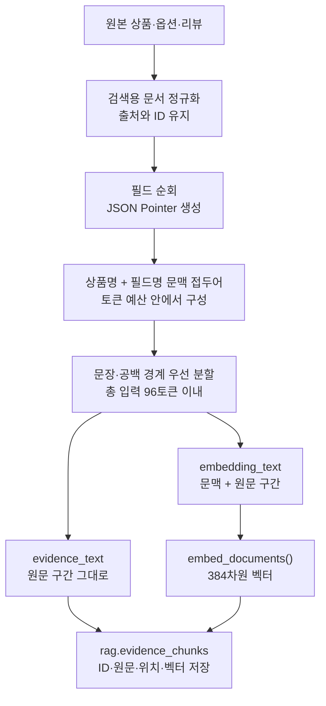

# 청킹과 임베딩

[목차](README.md) · [현재 데이터/저장 구조](datasets-and-storage.md)

## 1. 현재 설정과 이미 저장된 색인

| 구분 | 현재 상태 |
|---|---|
| 활성 test_items2 색인 | `source-evidence-token-v2:max_tokens=96` |
| 현재 배포 이미지의 청커 코드 | `source-evidence-token-v3` |
| 겹침 | 인접 청크 사이 overlap 없음 |
| 임베딩 모델 | `sentence-transformers/paraphrase-multilingual-MiniLM-L12-v2` |
| 벡터 크기 | 384차원 |
| 모델 호출 어댑터 | LangChain Community `FastEmbedEmbeddings` |
| 런타임 모델 입력 상한 | 128토큰 |
| 청크 입력 예산 | 96토큰, 문맥 접두어까지 포함 |
| 토큰 계산 | 실제 임베딩 어댑터가 로드한 토크나이저로 계산 |

코드를 v3로 바꿔도 DB에 있는 v2 청크·벡터는 바뀌지 않는다. 현재 두 활성 프로필의 run 메타데이터는 모두 v2를 가리킨다. [확인 증거](evidence/runtime-snapshot-2026-10-20.json).

## 2. 무엇을 청킹하는가

공통 청커는 원본을 검색용 문서로 정규화한 뒤 다음 필드를 나눈다.

| 대상 | 청킹 내용 | 별도로 보존할 정보 |
|---|---|---|
| 상품 | `title`, `features`, `description`, `details`의 의미 있는 값 | 상품 ID, 분류, 데이터 버전, 가격·통화, 출처 |
| 옵션 | 색인 입력에 반영된 옵션명·스펙 등 설명 | 원본 variant ID, 옵션별 단가·재고. 구매 가능 조건은 Commerce 조회로 확인 |
| 리뷰 | `text` 본문, 본문이 없으면 `title` | review ID, 상품/옵션 연결, 평점, 작성일, REAL/SYNTHETIC, 출처 |

원본 DB의 `name`, `body`, `specs_json` 등을 이 검색 문서 형태로 옮기는 단계와 청커 자체를 구분한다. DB 행 전체, 이미지 URL, 관리용 ID를 전부 의미 검색 문장으로 넣는 설계는 아니다.

## 3. 분할·저장 순서

- 문장/줄바꿈/공백 경계를 우선하고, 맞는 경계가 없으면 토큰 예산에 맞게 자른다.
- 원문 `start_offset`/`end_offset`을 보존하며 요약·의역해서 새 근거를 만들지 않는다.
- `evidence_text`는 인용할 원문 구간이다. `embedding_text`는 검색 모델에 넣는 문맥 포함 문자열이다.
- 상품명/필드명 접두어에도 예산을 배정한다. “본문 96토큰 + 별도 접두어”가 아니다.
- chunk ID에는 데이터·상품·범주·출처·필드·오프셋·청커 버전·모델 등의 해시 재료가 들어간다.
- 모델이 없어 정확한 토큰 계산기를 주지 않은 청커 단독 호출에는 보수적인 대체 계산이 있으나, 실제 색인 예산은 모델 토크나이저로 확인해야 한다.

구현: [chunker.py](../../src/toss_ads/rag/chunker.py), [embeddings.py](../../src/toss_ads/rag/embeddings.py), [types.py](../../src/toss_ads/rag/types.py).

## 4. 96토큰을 사용한 이유와 확인되지 않은 부분

초기 통합 결정은 모델 호출 상한 128보다 낮은 96을 두고 상품명·필드 문맥까지 함께 세는 방식이었다. 원문 위치가 명확한 작은 근거를 검색하려는 설계 선택이다. **96이 이 데이터에서 최적이라는 길이 비교 실험은 찾지 못했다.**

발견한 모델 비교는 기존 96토큰 청크를 고정했다. 모델 차이를 보려는 실험이므로 청크 크기에 따른 성능 비교로 해석할 수 없다. E5/BGE/Qwen도 비교 당시 최대 입력 128토큰을 사용했다. 다른 모델 토크나이저에서는 같은 문자열의 토큰 수가 달라질 수 있어 새 모델 적용 시 길이를 다시 검사해야 한다.

크기를 바꾸려면 동일한 사람 검수 질의/정답에서 64·96·120 등 후보를 별도 run으로 비교하고, 검색 적중률뿐 아니라 근거의 완결성·지연·비용을 함께 봐야 한다. 256토큰 이상은 현재 MiniLM 호출 설정을 그대로 둔 채 늘릴 수 없다. 이 문서 정리에서는 청크 크기 변경이나 새 실험을 실행하지 않았다.

초기 근거: [Git 기록의 통합 결정](document-catalog.md#08-architecture-integration). 실험 범위: [모델 비교 정리](model-comparisons-and-evaluation.md).

## 5. v3가 바꾼 점

| 내용 | 코드 상태 | 기존 색인에 미치는 영향 |
|---|---|---|
| 수집/평가 통계·관리용 필드 제외 | v3에 구현 | 재청킹해야 저장 청크 자체에서 제거됨 |
| 너무 짧은 마지막 리뷰 조각 | 합치거나 앞 조각과 경계 재배분 | 재청킹해야 새 경계 적용 |
| 원문·offset·토큰 상한 | 유지 | 출처 추적 규약 유지 |
| 기존 v2 근거의 검색 시 선별 | 관리 필드와 짧은 리뷰 조각을 조회 후 제외하는 로직 존재 | 청크 저장본을 바꾸지 않아도 선택 단계에 적용 가능 |

따라서 “v3 코드 있음”, “v3로 새 run 생성”, “그 run 활성화”는 서로 다른 상태다. 현재 확인한 상태는 첫 단계와 조회 시 근거 선별이며, 활성 test_items2 청크는 v2다.

## 6. 임베딩 모델별 자리와 저장 공간

| 모델 | 실험 차원 | 적용 상태 |
|---|---:|---|
| MiniLM-L12-v2 | 384 | 현재 API 기본. `evidence_chunks.embedding` |
| multilingual-e5-large | 1,024 | 두 beauty 데이터에서 오프라인 비교 |
| BGE-M3 | 1,024 | 오프라인 비교 및 beauty DB 벡터/검색 실험. 별도 임베딩 테이블, 현재 기본 API는 MiniLM |
| Qwen3-Embedding-0.6B | 1,024 | 두 beauty 데이터에서 오프라인 비교 |
| multilingual-mpnet-base-v2 | 768 | 문서에 후보로만 기록, 직접 비교 결과 없음 |

BGE의 sparse/ColBERT는 이번 비교에 포함되지 않았다. `bge-reranker-v2-m3`도 후보로 언급됐을 뿐 측정된 리랭커가 아니다. 질문에 답하는 LLM과 이 임베딩 모델들은 역할이 다르다.

## 7. 모델·청커를 바꿀 때 보존할 규약

1. 모델명·revision·차원·최대 입력·문서/질문 접두어를 함께 기록한다.
2. 같은 차원이어도 다른 모델의 벡터를 같은 공간에서 비교하지 않는다.
3. 청킹이 바뀌면 새 청크를 생성하고 재임베딩한다. 텍스트가 같고 모델만 바뀌면 기존 `embedding_text` 재사용 가능성을 별도 검토한다.
4. 완성 여부와 출처를 검증한 후 프로필/모델 설정을 맞춰 전환한다.
5. 예전 run/벡터와 복구 경로를 보존한다.

현재 BGE 확장 설계는 MiniLM `vector(384)`를 보존하고 별도 `vector(1024)` 테이블과 모델 프로필을 추가하는 방식이다. 자세한 실험·전환 계획은 [전체 목록의 설계/계획](document-catalog.md#07-designs-plans-progress)에 있다.
