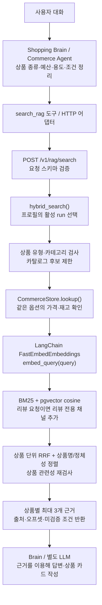

# 현재 RAG 구성

확인 시각: **2026-10-20 14:47 KST**. [목차](README.md) · [실행 상태 원본 JSON](evidence/runtime-snapshot-2026-10-20.json)

## 1. 실제 실행 상태

| 항목 | 확인한 값 |
|---|---|
| 검색 서비스 | `product-rag-api`, 내부 `http://127.0.0.1:8002` |
| 이미지 | `toss-ads-product-rag-service:24a1051-test-items2` |
| 검색 경로 | `POST /v1/rag/search` |
| 상태 확인 | `GET /healthz` → HTTP 200, 본문 `status=ok` |
| 검색 DB | **5432 / toss_rag / rag** |
| 상품·옵션 가격/재고 DB | **5432 / toss / test_items2** |
| 기본 프로필 | `test_items2` |
| 허용 프로필 | `test_items2`, `all_products` |
| 활성 test_items2 run | `e925490f-4f34-4c03-9248-eb9ebdfcde48` |
| 임베딩 | `sentence-transformers/paraphrase-multilingual-MiniLM-L12-v2`, 384차원 |
| 기존 색인의 청커 | `source-evidence-token-v2:max_tokens=96` |
| 실행 이미지에 들어 있는 청커 코드 | `source-evidence-token-v3` — 기존 색인을 다시 만든 것은 아님 |
| DB 확장 | `pg_search 0.26.0`, `vector 0.8.7` |

API·청커·임베딩·검색기·설정 모듈의 SHA-256을 실행 컨테이너와 Git 커밋 `24a1051`에서 대조했고 모두 일치했다. 이번 작업은 상태와 문서를 읽어 정리한 작업이며, 검색 품질 재평가나 모델·프로필 전환을 실행한 기록은 아니다.

## 2. 검색 요청의 흐름

실제로 확인한 실행 범위는 **RAG API → 두 DB**다. Brain/웹/LLM 부분은 연동 계약과 기존 Commerce 문서에 나타난 역할이며, 이 문서 정리 중 브라우저 대화에서 끝까지 실행해 확인하지는 않았다. RAG API 자체는 답변 생성 LLM을 호출하지 않는다.

## 3. 실행 메서드와 역할

| 위치 | 메서드/설정 | 역할 |
|---|---|---|
| [api.py](../../src/toss_ads/rag/api.py) | `create_app()` 및 검색 핸들러 | 서버 구성, 요청 검증, 스레드풀 실행, 오류를 HTTP/JSON 상태로 변환 |
| [schemas.py](../../src/toss_ads/rag/schemas.py) | `RagSearchRequest.model_validate()` | profile/category/product_type/가격/재고/top_k 등의 입력 검증 |
| [retriever.py](../../src/toss_ads/rag/retriever.py) | `hybrid_search()` | 활성 데이터 선택부터 후보 자격·검색·순위·근거 반환까지 조정 |
| [store.py](../../src/toss_ads/rag/store.py) | `active_run()`, `supported_categories()`, `product_catalog()` | 선택한 프로필의 데이터 범위와 상품 스냅샷 조회 |
| [intent.py](../../src/toss_ads/rag/intent.py) | `type_registry()` 및 유형/어휘 검사 | 상품군·상하위 유형·별칭과 카테고리 일치 확인 |
| [commerce.py](../../src/toss_ads/rag/commerce.py) | `CommerceStore.lookup()` | 원본 옵션의 가격·재고를 읽어 추천 자격 확인 |
| [embeddings.py](../../src/toss_ads/rag/embeddings.py) | `create_embedder()`, `embed_query()` | LangChain FastEmbed 어댑터 생성, 질문을 384차원 벡터로 변환 |
| [retriever.py](../../src/toss_ads/rag/retriever.py) | `_channel_candidates()` | 서로 다른 상품을 확보하도록 채널별 검색 창 확대 및 중복 청크 제한 |
| [store.py](../../src/toss_ads/rag/store.py) | `search_bm25()`, `search_vector()` | ParadeDB BM25, pgvector 코사인 거리 검색 |
| [retriever.py](../../src/toss_ads/rag/retriever.py) | `_usable_evidence()` | 관리용 필드·의미 없는 짧은 리뷰 조각을 근거 선택에서 제외 |

현재 요청은 청킹·문서 임베딩을 다시 실행하지 않는다. 이미 저장된 청크를 검색하고, 요청의 질문 벡터만 메모리에서 계산한다.

## 4. 검색 후보와 순위 정책

| 설정/정책 | 현재 값 또는 동작 |
|---|---|
| 카테고리 | 생략하면 선택한 프로필의 전체 범주. 명시하면 해당 범주만 |
| 상품 유형 | 명시한 `product_type` 또는 원문·검색어의 유형을 검사. 충돌·모호함은 빈 결과로 재질문 유도 |
| 가격·재고 | 검색 전 적격 카탈로그 전체에 적용. **같은 variant**가 두 조건을 만족해야 함 |
| 채널별 상품 목표 | 기본 50개 (`RAG_CANDIDATE_DEPTH`) |
| 채널별 상품당 청크 | 최대 3개 |
| 후보 탐색 상한 | 최대 2,000청크까지 창 확대. 50개 확보를 항상 보장하지 않음 |
| `RAG_CHANNEL_DEPTH` | 20. 현재 후보 확장 로직과 함께 쓰므로 항상 Top 20만 검색한다는 뜻은 아님 |
| 검색 채널 | 전체 BM25/벡터. 명시적인 후기 요청이면 리뷰 전용 BM25/벡터도 결합 |
| RRF | 상품의 채널 순위에 `1 / (60 + rank)`를 합산 |
| 최종 정렬 | 상품명/정체성 어휘 일치 → 상품 RRF → 안정적인 상품 ID |
| 최종 상품 수 | `top_k`: 기본 10, 허용 1~20, 적격 상품이 적으면 더 적게 반환 |
| 상품별 근거 | 최대 3개. 동일 리뷰 중복을 줄이고 REAL 리뷰를 우선 |
| RRF 컷오프 | `min_rrf_score=null`. 별도로 상품 정체성 검사는 적용됨 |
| 모델 리랭커 | 현재 배포본에 cross-encoder 리랭커 없음. 결정적 규칙으로 재정렬 |

RRF 점수, 어휘 커버리지, `relevance_qualified`는 사람이 검수한 정확도나 관련성 확률이 아니다. 임의의 `required_conditions`/`preferences` 문장은 검증되지 않으면 `unverified_conditions`에 남는다.

## 5. LangChain은 현재 어디에 쓰이는가

| 구성 | 확인 시점의 상태 |
|---|---|
| LangChain `FastEmbedEmbeddings` | **실제 사용**. 검색 시 `embed_query()`, 색인 생성 경로에서 `embed_documents()` 인터페이스 제공 |
| `HybridRagRetriever(BaseRetriever)` | 현재 배포 소스에도 존재. 결과를 LangChain `Document`로 변환하는 어댑터 |
| 현재 HTTP 검색 | **`hybrid_search()` 직접 호출**. 현재 배포본은 `HybridRagRetriever.invoke()` 경유 아님 |
| `feature/rag-langchain-http`의 HTTP 연결 | `search(request) → invoke() → _get_relevant_documents()` 구현과 10/18 검증 기록이 별도로 존재 |
| Brain의 도구 선택·대화·최종 LLM 답변 | 별도 Agent 계층. 이 Python 검색 API 전체가 LangChain Agent인 것은 아님 |

현재 배포본에는 구조화 요청용 `HybridRagRetriever.search()`가 없다. 10/18 문서의 “HTTP 연결 후 실제 사용” 설명은 **그 브랜치의 구현/검증 시점**을 가리킨다. 현재 배포된 `24a1051`의 상태를 대신하지 않는다.

관련 원문: [LangChain HTTP 연결 구성도](archive/langchain-http/deploy/product-rag-runtime/docs/langchain-architecture.md), [현재 추천 품질 구현 설명](archive/quality/docs/rag-recommendation-quality.md).

## 6. BGE-M3의 현재 위치

`5432/toss_rag`에 같은 run의 **beauty 78,595청크**용 BGE-M3 1,024차원 임베딩 프로필이 `ready`로 존재한다. 기존 MiniLM 벡터와 별도 테이블에 저장했다. 확인 시점 API 모델 설정은 MiniLM이며, BGE-M3 전체 카테고리 운영 전환 완료를 의미하지 않는다.

별도 브랜치에는 전체 114,106청크 활성화 설계·구현 진행 기록이 있다. 해당 브랜치가 계속 변경될 수 있으므로 [발견한 전체 문서 목록](document-catalog.md)과 확인 시각을 함께 본다. 모델 실험 수치는 [모델 비교·평가 정리](model-comparisons-and-evaluation.md)에 모았다.

## 7. 문서 충돌 시 적용 기준

1. 해당 시각의 컨테이너 설정·코드 해시·DB 프로필을 담은 실행 증거를 확인한다.
2. 같은 데이터 버전·run·코드 버전의 적용 기록과 API 계약을 읽는다.
3. 과거 설계·실험·PDF는 작성 당시의 자료로 사용한다.

`all_products`라는 이름이 최신 전체 상품을 뜻하지 않는다. 현재는 이전 `test_items` 180개 상품 프로필이다. `docs/product-rag-service.md` 및 일부 오래된 구성도에 적힌 beauty/이어폰 전용 설명도 현재 기본값으로 사용하지 않는다.
