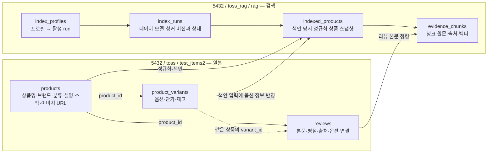

# 데이터셋과 저장 구조

[목차](README.md) · 상태 기준: 2026-10-20 14:47 KST

## 1. 현재 기본 데이터: test_items2

| 항목 | 값 |
|---|---|
| 입력 자료 | `shopping_brain_v6_1_review_refined_CANDIDATE.zip` |
| 원본 버전 | `v6.1-review-refined` |
| 입력 ZIP SHA-256 | `94681a28271ca9b1a6039c98bef10d23cd87beb33004555b9a74d0ca93ccfd8e` |
| 상품 / 옵션 / 리뷰 | **1,500 / 1,917 / 46,100** |
| 리뷰 출처 구분 | REAL 41,523 / SYNTHETIC 4,577 |
| 원본 DB | `5432 → toss → test_items2` |
| 검색 DB | `5432 → toss_rag → rag` |
| 프로필 / run | `test_items2` / `e925490f-4f34-4c03-9248-eb9ebdfcde48` |
| 전체 청크 | **114,106**: 상품·옵션 37,919 / 리뷰 76,187 |
| 벡터 | MiniLM 384차원. 각 청크에 저장 |

dataset_version:

```text
test_items2:v6.1-review-refined:sha256=94681a28271ca9b1:products=1500:reviews=46100
```

상품/옵션/리뷰 수와 REAL/SYNTHETIC 수는 이번 읽기 전용 DB 조회에서도 확인했다. 이 데이터는 내부 개발용 **CANDIDATE**다. REAL 표시는 제공자가 부여한 실수집 출처 구분이며, 실제 구매·상품 효능·옵션 연결의 정확성을 독립적으로 검수했다는 뜻은 아니다. 합성 리뷰를 실제 구매 후기처럼 표시하면 안 된다. 가격도 현시점 외부 판매가로 보장하지 않는다.

근거: [원본 데이터 README](archive/project/data/test_items2/source/shopping_brain_v6_1_common_dataset/README.md), [적재 보고서](archive/project/data/test_items2/load_report.json), [색인 보고서](archive/project/data/test_items2/index_report.json), [현재 실행 증거](evidence/runtime-snapshot-2026-10-20.json).

## 2. 카테고리별 범위

| 카테고리 | 상품 | 리뷰 | 상품 청크 | 리뷰 청크 | 전체 청크 |
|---|---:|---:|---:|---:|---:|
| beauty | 781 | 34,545 | 19,485 | 59,110 | 78,595 |
| fashion | 269 | 2,761 | 8,128 | 3,438 | 11,566 |
| food | 182 | 5,682 | 4,364 | 9,045 | 13,409 |
| living | 268 | 3,112 | 5,942 | 4,594 | 10,536 |
| **합계** | **1,500** | **46,100** | **37,919** | **76,187** | **114,106** |

“다양한 카테고리를 지원하는 구조”와 “모든 종류의 상품이 현재 들어 있음”은 구분해야 한다. 현재 기본 run이 지원하는 범주는 위 네 가지다. 새 상품은 원본 적재만으로 검색되지 않으며 색인과 프로필 반영이 필요하다.

## 3. 원본과 검색 저장소의 관계



두 DB 사이 연결은 서비스/ETL에서 ID와 출처 메타데이터로 관리한다. 일반 PostgreSQL 연결에서 서로 다른 DB 테이블을 바로 JOIN하거나 DB 간 외래키가 있다고 가정하지 않는다.

### 원본 테이블

| 테이블 | 핵심 필드 | 의미 |
|---|---|---|
| `test_items2.products` | `id`, `name`, `brand`, `category`, `description`, `image_urls`, `specs_json`, `active`, `version` | 상품 정체성과 설명. 이미지는 URL 배열이며 이미지 파일/이미지 임베딩이 아님 |
| `test_items2.product_variants` | `id`, `product_id`, `option_values_json`, `spec_overrides_json`, `unit_price_won`, `stock_qty`, `active`, `version` | **가격·재고는 옵션 단위**. 상품당 여러 옵션 가능 |
| `test_items2.reviews` | `id`, `product_id`, `variant_id`, `rating`, `body`, `source_kind`, `source_ref`, `written_at`, `source_option_label` | 평점 1~5, REAL/SYNTHETIC, 본문 및 원본 옵션 표기 보존 |

`reviews.variant_id`는 NULL 가능하다. 값이 있을 때 `(product_id, variant_id)`가 같은 상품의 옵션을 참조하도록 복합 FK가 있다. `source_option_label`은 원문 라벨이며 검증된 옵션 ID와 동일한 의미가 아니다.

입력 JSON의 `specs`, `option_values`, `spec_overrides`는 각각 DB의 `specs_json`, `option_values_json`, `spec_overrides_json`으로 매핑한다. [원본 DDL](archive/quality/docs/handover/rag-db-operations-2026-10-19/toss.test_items2.schema.sql).

### 검색 테이블

| 테이블 | 역할 |
|---|---|
| `rag.index_profiles` | `profile_name → active_run_id` 포인터 |
| `rag.index_runs` | 데이터 버전·임베딩 모델·청커·상태·수량. 프로필별 활성 run 관리 |
| `rag.indexed_products` | 색인용 정규화 상품 스냅샷. 원본 상품 DB를 대체하는 테이블이 아님 |
| `rag.evidence_chunks` | `evidence_text`, `embedding_text`, `vector(384)`, 원본 위치와 메타데이터 |
| `rag.quarantined_products` | 분류 문제 등으로 검색에서 격리한 상품과 사유 |
| `rag.index_run_embedding_profiles` | 추가 BGE-M3 모델의 run별 준비 상태·차원·범위 |
| `rag.evidence_chunk_embeddings` | 기존 청크에 연결한 별도 `vector(1024)` 임베딩 |

기존 DB의 [RAG DDL 스냅샷](archive/quality/docs/handover/rag-db-operations-2026-10-19/toss_rag.rag.schema.sql)과 [BGE 추가 DDL](archive/bge-m3/deploy/product-rag-bge-m3-embeddings.sql)은 작성 시점이 다르다. 전자는 BGE 테이블을 포함하지 않는다. 이 자료들은 구조 설명이며 실행할 마이그레이션 명령으로 취급하지 않는다.

### 청크에서 원본으로 돌아가는 방법

- `product_id` → 원본 `products.id`.
- 리뷰 청크의 `source_id` → 원본 `reviews.id`.
- `source_type`, `source_field`(JSON Pointer), `start_offset`, `end_offset`, `source_metadata` → 색인에 사용한 문서의 해당 구간.
- `run_id`와 `dataset_version` → 어느 데이터·청커·모델로 만들어졌는지.

오프셋은 **색인 입력으로 정규화된 필드**를 기준으로 한다. 원본 DB 필드명과 JSON Pointer가 항상 같은 것은 아니다. 화면에는 반환된 `evidence_text`를 인용하고, 원본 재대조 때 정규화·마스킹 규칙도 맞춘다.

## 4. 과거 데이터와 현재의 구분

| 자료 | 규모 | 현재 해석 |
|---|---|---|
| Amazon Reviews'23 선별 원본 | 3만 상품 / 178,335리뷰, 가전·의류·식료품 각각 1만 상품 | 초기 원본 수집·마이그레이션 자료 |
| 그중 Appliances 색인 | 1만 상품 / 65,618리뷰 / 287,105청크 | 10/15 과거 실험. 현재 test_items2 품질 수치와 합산 불가 |
| `test_earphones` | 과거 인수인계 기록: 50상품 / 50옵션 / 1,000리뷰 | 이어폰 연동 실험 원본. 현재 기본 프로필 아님 |
| `test_items` | 180상품 / 180옵션 / 4,737리뷰 / 6,741청크 | 현재 `all_products` 프로필. beauty만 있고 리뷰·가격·재고·옵션은 모의 데이터 |
| `test_items2` | 1,500상품 / 1,917옵션 / 46,100리뷰 / 114,106청크 | **현재 API 기본 프로필** |

과거 수량의 출처: [초기 Amazon README](archive/old-project-worktree/data/amzdata/README.md), [인수인계서](archive/quality/docs/handover/rag-db-operations-2026-10-19/rag-db-operations-handover-2026-10-19.md), [test_items 내보내기 설명](archive/export-test_items_complete_2026-10-18/README_KO.md). 과거 이어폰 수량·가전 데이터의 현재 잔존 수량을 이번에 전수 재조회한 것은 아니다.

## 5. 파일 형태의 자료

| 자료 | 기존 위치 |
|---|---|
| test_items2 입력 README·보고서 | `/home/aiteam/projects/toss-ads-project/data/test_items2/` |
| 입력 상품/옵션/리뷰 JSON | 위 경로의 `source/shopping_brain_v6_1_common_dataset/data/` |
| test_items2 원본+전체 청크+전체 벡터 ZIP | `/home/aiteam/projects/toss-ads-project/data/exports/test_items2_chunked_full_2026-10-19.zip` |
| test_items 원본+DB 내보내기 ZIP | `/home/aiteam/projects/toss-ads-project/data/exports/test_items_complete_2026-10-18.zip` |

test_items2 ZIP은 273,558,559바이트이며 청크의 **전체 384차원 숫자 벡터**를 포함한다. 이번 문서 묶음에는 대용량 원본·벡터 덤프를 중복 복사하지 않았고 README·manifest·체크섬과 위치를 수록했다. [전체 위치/파일 목록](source-manifest.json), [내보내기 읽는 법](archive/export-test_items2_chunked_full_2026-10-19/README_KO.md).

## 6. 새 상품을 넣을 때 필요한 운영 연결

1. 상품·옵션·리뷰의 ID, 유형, 옵션 가격·재고, 출처를 원본 DB에 적재한다.
2. 공통 정규화·청킹·임베딩으로 **새 run**을 생성하고 수량·출처·오프셋을 검사한다.
3. 동일 모델/차원의 완성된 임베딩을 확인한 뒤 프로필 포인터와 API 허용 범위를 일치시킨다.
4. Brain/Commerce가 같은 상품·옵션 ID를 사용하도록 연결한다.
5. 새 상품군의 사람 검수 질문과 OOD/가격/필수 옵션 사례로 평가한다.

초기 test_items2 적재는 별도 worker로 수행된 기록이 있다. 임시 worker의 재실행을 일반 운영 CLI로 보장하지 않으며, 영구적인 증분 적재·재색인 진입점 정리는 후속 과제다. 상품마다 개별 검색 코드를 작성하는 방식으로 확장하지 않는다.
